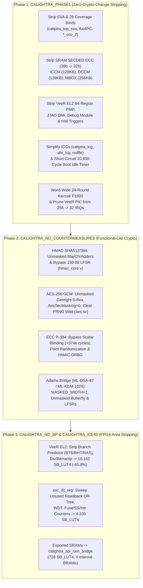

<!-- SPDX-License-Identifier: Apache-2.0 -->

# Calightra: Architectural & Implementation Details (`caliptra-rtl` 2.1 Core)

This document contains the granular architectural details, stripping phase descriptions, subsystem-by-subsystem synthesis breakdowns, full 31.5M-cycle Verilator boot trace, and FPGA development board comparison for **Calightra** ([`caliptra-rtl/`](caliptra-rtl/) + [`sim/`](sim/) + [`fpga/`](fpga/)).

For the high-level summary, bottom-line results, and quick-start commands, see [`README.md`](README.md). For the full dual-VeeR-EL2 **Caliptra 2.1 Subsystem** (`caliptra-ss` + MCU + MCI + OTP/LC + MIPI I3C + AXI4 crossbar), see the `caliptra-ss` branch.

---

## 1. Architecture & Stripping Phases

---

## 2. Verilator Build & Simulation Benchmark Details

All simulation benchmarks are built and run via [`sim/Makefile`](sim/Makefile) and driven by the C++ SoC harness [`sim/boot_sim.cpp`](sim/boot_sim.cpp) executing the unmodified `caliptra-sw` `rom-2.1.3-1` binaries in [`fw/`](fw/).

### 2.1 Build Time, Model Size & ROM Boot Comparison

| Metric | Baseline (`out_baseline`) | Phase 1 (`CALIGHTRA_PHASE1`) | Phase 2 (`+ CALIGHTRA_NO_COUNTERMEASURES`) | Improvement (Phase 2 vs. Baseline) |
| :--- | :---: | :---: | :---: | :---: |
| **Verilator Build Time** | `404.21 s` | `53.20 s` | **`53.69 s`** | **7.53x faster** (`-86.7%`) |
| **Archive Size (`libcaliptra_verilated.a`)** | `108.0 MB` | `6.1 MB` | **`5.6 MB`** | **19.3x smaller** (`-94.8%`) |
| **Simulator Binary (`boot_sim`)** | `64.0 MB` | `3.3 MB` | **`3.1 MB`** | **20.6x smaller** (`-95.2%`) |
| **Cycles to `ready_for_fuses`** | `22,299` | `12,298` | **`12,298`** | **`-10,001` cycles (`-44.8%`)** |
| **Cycles to `ready_for_mb_processing` (ROM + KATs)** | `5,548,472` | `5,538,471` | **`4,626,321`** | **`-922,151` cycles (`-16.6%`)** |
| **Simulation Speed (kHz)** | `1.53 kHz` | `2.51 kHz` | **`2.54 kHz`** | **1.66x faster kHz** |
| **Wall-Clock Time to `ready_for_mb_processing`** | `3,636.30 s` (`60.6 min`) | `2,208.13 s` (`36.8 min`) | **`1,821.17 s` (`30.4 min`)** | **2.00x faster wall-clock** |

### 2.2 Full End-to-End Boot (`ROM` $\to$ `FMC` $\to$ `Runtime` $\to$ `FW_INFO`)

Using the Phase 2 build (`sim/out_phase2/boot_sim` with `+full_boot`, full log in [`sim/logs/full_boot_phase2.log`](sim/logs/full_boot_phase2.log)), we booted the unmodified production ROM (`caliptra-rom.bin`) and signed ML-DSA/ECDSA firmware bundle (`image-bundle-mldsa.bin`, 253,440 bytes) through every boot milestone:

| Boot Stage / Milestone | Cycle Count | Delta Cycles | Elapsed Wall Time | Description |
| :--- | :---: | :---: | :---: | :--- |
| **`[Stage 1]` `ready_for_fuses`** | `12,298` | `+12,298` | `4.8 s` | Cold reset deasserted, ICCM/DCCM/MBOX zeroed |
| **`[Stage 1b]` `BOOTFSM_GO`** | `12,495` | `+197` | `4.9 s` | SoC fuse programming & `CPTRA_FUSE_WR_DONE` complete |
| **`[Stage 2]` `ready_for_mb_processing`** | `4,626,321` | `+4,613,826` | `1,821.2 s` | All ROM KATs pass (`SHA2-256/384/512`, `SHA3/SHAKE256`, `HMAC`, `LMS`, `ECDSA-P384`, `ECDH`, `ML-DSA-87`), `IDevId` (`0x01..0x0C`) complete |
| **`[Stage 3]` `FW_LOAD` Uploaded** | `4,816,531` | `+190,210` | `1,896.1 s` | `253,440` bytes (`63,360` dwords) streamed into Mailbox SRAM via AXI |
| **`LDevId` Complete (`0x46`)** | `11,650,006` | `+6,833,475` | `4,678.5 s` | `LDevId` CDI derivation, keypair generation, and X.509/TBS cert construction |
| **`[Stage 4]` `FW_LOAD` Verified (`0x87`)** | `18,570,005` | `+6,919,999` | `7,481.2 s` | Vendor & Owner P-384 + ML-DSA-87 manifest signature verification, TOC SHA2-384 verification, FMC + RT loaded into ICCM |
| **`ColdResetComplete` (`0x140`) / FMC Entry** | `24,150,006` | `+5,580,001` | `9,740.3 s` | `FmcAlias` (`0xC1..0xC6`) P-384 + ML-DSA-87 keypair/cert signing complete; jumps to FMC (`Running Caliptra FMC ...`) |
| **Runtime Entry (`0x406`)** | `30,880,000` | `+6,729,994` | `12,461.9 s` | FMC derives `AliasRt` (`0x400..0x404`), signs P-384 + ML-DSA-87 RT Alias certs, jumps to `Caliptra RT` |
| **`[Stage 5]` `ready_for_runtime` HIGH** | **`31,476,657`** | `+596,657` | `12,703.5 s` | Runtime executes `AES-ECB`, `AES-CBC`, `AES-CTR`, `AES-CMAC`, and `ML-KEM-1024` KATs and asserts `ready_for_runtime` |
| **`[Stage 6]` `FW_INFO` Response Validated** | **`31,502,733`** | `+26,076` | **`12,713.6 s`** | SoC sends `FW_INFO` (`0x494e464f`), Runtime responds with `396` bytes (`fips_status = 0x00000000`, `fw_svn = 0`) |

---

## 3. Open-Source FPGA Synthesis & Area Breakdown (`fpga/`)

The automated `sv2v` + `yosys` + `nextpnr` flow lives in [`fpga/`](fpga/):
- [`fpga/Makefile`](fpga/Makefile): One-command synthesis and place-and-route targets (`make -C fpga ulx3s-85f`, `make -C fpga ice40`, `make -C fpga pnr-ecp5`, `make -C fpga blocks`).
- [`fpga/ulx3s_top.sv`](fpga/ulx3s_top.sv) & [`fpga/ulx3s_v20.lpf`](fpga/ulx3s_v20.lpf): Radiona ULX3S-85F top-level wrapper with an onboard ESP32 SPI-to-AXI4-Lite host bridge, 115,200-baud FTDI UART TX serializer, and 8 status LEDs.
- [`fpga/calightra_spi_ram_bridge.sv`](fpga/calightra_spi_ram_bridge.sv): Bridges the exported ECC-free ICCM (8 banks $\times$ 16 KB), DCCM (8 banks $\times$ 16 KB), Mailbox SRAM (256 KB), and IMEM/ROM (96 KB) interfaces into a single external QSPI PSRAM/Flash interface (`728 SB_LUT4`, `0` internal BRAMs).
- [`fpga/calightra_fpga_top.sv`](fpga/calightra_fpga_top.sv): Provides both `calightra_fpga_top` (with exported parallel SRAM ports) and `calightra_spi_top` (integrating `calightra_fpga_top` + `calightra_spi_ram_bridge`).

### 3.1 Subsystem-by-Subsystem Area Reduction (Lattice iCE40 Primitives)

| Module / Subsystem | Configuration | `SB_LUT4` | `SB_DFF*` | `SB_CARRY` | `SB_MAC16` | Latches | LUT4 Reduction |
| :--- | :--- | :---: | :---: | :---: | :---: | :---: | :---: |
| **[`el2_veer`](caliptra-rtl/src/riscv_core/veer_el2/rtl/el2_veer.sv)** (VeeR EL2 RISC-V Core) | Baseline (`patch_v2.1`) | `53,064` | `18,162` | `3,873` | `0` | `1,040` | — |
| **[`el2_veer`](caliptra-rtl/src/riscv_core/veer_el2/rtl/el2_veer.sv)** | Phase 1 (No PMP/Dbg/Triggers, 32-IRQ PIC) | `37,087` | `11,226` | `3,128` | `0` | `0` | `-30.1%` (`1.43x`) |
| **[`el2_veer`](caliptra-rtl/src/riscv_core/veer_el2/rtl/el2_veer.sv)** | **`+ CALIGHTRA_NO_BP` + `-dsp`** (No BTB/BHT/RAS/Div/Zbb) | **`18,162`** | **`6,149`** | **`1,082`** | **`4`** | **`0`** | **`-65.8%` (`2.92x`)** |
| **[`hmac_ctrl`](caliptra-rtl/src/hmac/rtl/hmac_ctrl.sv)** (HMAC-SHA512/384) | Baseline (Masked SHA-512 + 159b LFSR) | `45,231` | `14,835` | `3,114` | `0` | `0` | — |
| **[`hmac_ctrl`](caliptra-rtl/src/hmac/rtl/hmac_ctrl.sv)** | **`CALIGHTRA_NO_COUNTERMEASURES`** (Unmasked) | **`18,921`** | **`7,523`** | **`2,198`** | **`0`** | **`0`** | **`-58.2%` (`2.39x`)** |
| **[`aes_clp_wrapper`](caliptra-rtl/src/aes/rtl/aes_clp_wrapper.sv)** (AES-256-GCM) | Baseline (DOM Masked S-Box + 5 PRNGs) | `29,734` | `9,302` | `853` | `0` | `0` | — |
| **[`aes_clp_wrapper`](caliptra-rtl/src/aes/rtl/aes_clp_wrapper.sv)** | **`CALIGHTRA_NO_COUNTERMEASURES`** (Unmasked Canright) | **`25,232`** | **`4,691`** | **`781`** | **`0`** | **`0`** | **`-15.1%` (`-49.6%` FFs)** |
| **[`ecc_top`](caliptra-rtl/src/ecc/rtl/ecc_top.sv)** (ECDSA/ECDH P-384) | Baseline (Masked + Scalar Blinding + HMAC_DRBG) | `157,571` | `52,260` | `9,543` | `100` | `0` | — |
| **[`ecc_top`](caliptra-rtl/src/ecc/rtl/ecc_top.sv)** | **`CALIGHTRA_NO_COUNTERMEASURES`** (Unblinded) | **`125,677`** | **`42,728`** | **`8,434`** | **`96`** | **`0`** | **`-20.2%` (`-31,894` LUTs)** |
| **[`calightra_spi_ram_bridge`](fpga/calightra_spi_ram_bridge.sv)** | 4-Port Arbiter + QSPI RAM/Flash Controller | **`728`** | **`246`** | **`3`** | **`0`** | **`0`** | Replaces `608 KB` SRAM |
| **`soc_ifc_top` + `mbox` + `axi` + Vaults** | Baseline (inside `calightra_fpga_top`) | `~26,214` | `~6,721` | `~10,107` | `0` | `0` | — |
| **`soc_ifc_top` + `mbox` + `axi` + Vaults** | **`+ CALIGHTRA_ICE40`** (Unused CSR/WDT/Counter sweep) | **`4,105`** | **`1,385`** | **`449`** | **`0`** | **`0`** | **`-84.3%` (`6.39x`)** |
| **Full [`calightra_spi_top`](fpga/calightra_fpga_top.sv)** | **All 5 Defines (`PHASE1` + `NO_CM` + `NO_BP` + `ICE40`)** | **`22,995`** | **`7,780`** | **`1,534`** | **`4`** | **`0`** | **Full Core + SPI Bridge** |

### 3.2 Recommended Open-Source FPGA Development Boards & Pricing

| Board Name | FPGA Part & Package | Capacity (LUT4s / EBR RAM) | External RAM / Flash | Approx. Price (USD) | Why It Fits Well |
| :--- | :--- | :---: | :--- | :---: | :--- |
| **Radiona ULX3S (45F or 85F)** | `LFE5U-45F-6BG381C` or `LFE5U-85F-6BG381C` | `43,848` or `83,640` LUT4 / up to `432 KB` EBR | `32–64 MB` SDRAM + `16 MB` QSPI Flash + **ESP32** | **~$155 (45F)** / **~$215 (85F)** (Crowd Supply / Mouser) | Flagship OSHW ECP5 board; `85F` uses `35%` for Calightra Core (`ulx3s_top.sv`) and `85%` for full `caliptra-ss`; onboard **ESP32** acts as the SoC SPI/AXI host. |
| **Muse Lab Colorlight i9+ (with Extender Board)** | `LFE5U-45F-6BG381C` (`CABGA381`) | `43,848` LUT4 / `216 KB` EBR | `8 MB` SDRAM + `16 MB` QSPI Flash | **~$25 – $35** (AliExpress / Tindie) | Lowest-cost board using the `LFE5U-45F-CABGA381` chip & package (`70%` utilization). |
| **Lattice ECP5-5G Evaluation Board (`ECP5-5G-EVN`)** | `LFE5UM5G-85F-8BG381C` (`CABGA381`) | `83,640` LUT4 / `432 KB` EBR | `16 MB` QSPI Flash + Arduino/Versa headers | **~$135 – $150** (DigiKey / Mouser) | Official Lattice evaluation board in stock at major distributors. |
| **OrangeCrab r0.2 (85F)** | `LFE5U-85F-8MG285C` (`CSFBGA285`) | `83,640` LUT4 / `432 KB` EBR | `128 MB` DDR3 + `16 MB` QSPI Flash | **~$145 – $175** (Crowd Supply / GroupGets) | Feather form-factor OSHW board with native USB bootloader. |
| **Colorlight i5 / iCESugar-Pro (25F)** *(with Vaults in EBR)* | `LFE5U-25F-6BG256C` / `CABGA381` | `24,288` LUT4 / `112 KB` EBR | `8–32 MB` SDRAM + `16 MB` QSPI Flash | **~$20 – $40** | Mapping `kv`/`pv`/`dv` flip-flop banks into `DP16KD` EBRs drops logic under `20k` LUT4s to fit on `25F` boards. |

---

## 4. Repository Structure (`caliptra-core` Branch)

- [`README.md`](README.md): Concise TL;DR summary, bottom-line synthesis/simulation metrics, ULX3S-85F pinout, and quick-start commands.
- [`DETAILS.md`](DETAILS.md): This document — detailed architecture, stripping phases, block-level area tables, and boot logs.
- [`sim/`](sim/): Verilator build system and C++ SoC/AXI/Mailbox/Fuse simulation harness (`sim/Makefile`, `sim/boot_sim.cpp`, `sim/calightra_top.vf`, `sim/caliptra_verilated.sv`, `sim/logs/full_boot_phase2.log`).
- [`fpga/`](fpga/): Open-source FPGA synthesis (`sv2v` + `yosys`) and place-and-route (`nextpnr`) flow (`fpga/Makefile`, `fpga/ulx3s_top.sv`, `fpga/ulx3s_v20.lpf`, `fpga/calightra_fpga_top.sv`, `fpga/calightra_spi_ram_bridge.sv`, `fpga/calightra_ice40.vf`, `fpga/run_sv2v.py`, `fpga/synth_blocks.py`, `fpga/logs/`).
- [`patches/`](patches/): Standalone git diffs against upstream [`caliptra-rtl.patch`](patches/caliptra-rtl.patch) (`188b0b0e`) and [`adams-bridge.patch`](patches/adams-bridge.patch) (`b77e3d89`).
- [`fw/`](fw/): Unmodified [`chipsalliance/caliptra-sw`](https://github.com/chipsalliance/caliptra-sw) `rom-2.1.3-1` release binaries (`caliptra-rom.bin`, `caliptra-rom-with-log.bin`, `image-bundle-mldsa.bin`, `image-bundle-lms.bin`).
- [`caliptra-rtl/`](caliptra-rtl/): Full Caliptra 2.1 RTL source tree with `CALIGHTRA_PHASE1`, `CALIGHTRA_NO_COUNTERMEASURES`, `CALIGHTRA_NO_BP`, and `CALIGHTRA_ICE40` `ifdef` guards applied.
