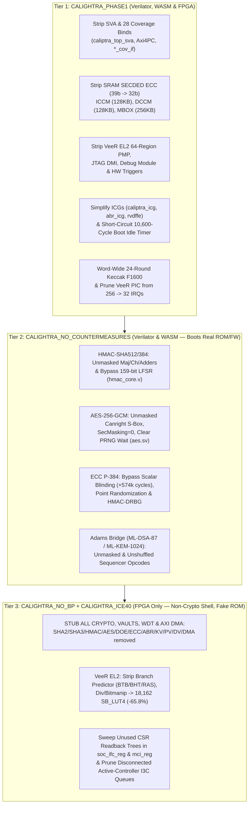

<!-- SPDX-License-Identifier: Apache-2.0 -->

# Calightra & Calightra-SS: Architectural & Implementation Details

This document provides the exact architectural details, stripping-phase definitions, block-by-block LUT4 synthesis measurements, AXI4 crossbar address map, Radiona ULX3S-85F pinout, and hardware/simulation boot traces for **Calightra-SS** ([`caliptra-ss/`](caliptra-ss/) + [`ss/`](ss/)) and **Calightra Core** ([`caliptra-rtl/`](caliptra-rtl/) + [`sim/`](sim/) + [`fpga/`](fpga/)).

For the high-level summary and quick-start commands, see [`README.md`](README.md).

---

## 1. Stripping Tiers: What Is Included vs. What `CALIGHTRA_ICE40` Removes on FPGA

> [!WARNING]
> **Why Current FPGA Bitstreams (`fpga/` and `ss/fpga/`) Do Not Include Hardware Cryptography:**
> Even after stripping side-channel masking and scalar blinding (`CALIGHTRA_NO_COUNTERMEASURES`), upstream Caliptra 2.1's parallel ASIC cryptographic blocks and flip-flop vaults require **`~410,000` 4-input LUTs** (`ecc_top` P-384 = `125,677` LUTs, `abr_top` Adams Bridge ML-DSA-87 / ML-KEM-1024 = `~180,000+` LUTs, `aes_clp_wrapper` = `25,232` LUTs, `hmac_ctrl` = `17,925–18,921` LUTs, plus `sha256_ctrl`, `sha512_ctrl`, `sha512_acc_top`, `sha3_ctrl`, `doe_ctrl`, `key_vault`, `pcr_vault`, and `data_vault`). That is roughly **5x larger** than the entire `83,640`-LUT Lattice ECP5-85F (`LFE5U-85F-6BG381C`) on the Radiona ULX3S-85F.
>
> Because of this, **all FPGA synthesis targets** (`fpga/Makefile` and `ss/fpga/Makefile`) compile with **`-DCALIGHTRA_ICE40`**, which **stubs out every cryptographic engine, hardware vault, WDT, and `axi_dma_top`**. Only the Verilator (`sim/`, `ss/sim/`) and WebAssembly (`wasm/`, `www/`) targets include the cryptographic engines and boot the real `caliptra-rom.bin`.

| Capability / Block | Verilator (`sim/`, `ss/sim/`) & WASM (`www/`) (`PHASE1` + `NO_COUNTERMEASURES`) | ULX3S-85F FPGA (`ss/fpga/`, `fpga/`) (`+ NO_BP` + `CALIGHTRA_ICE40`) |
| :--- | :---: | :---: |
| **Caliptra Core VeeR EL2 RISC-V CPU** | Included (no PMP/debug/triggers) | Included (`+ CALIGHTRA_NO_BP`: no BTB/BHT/RAS/div/bitmanip) |
| **Subsystem MCU VeeR EL2 + `mci` + `otp` + `lc` + `i3c`** | Included in `ss/sim/` | Included in `ss/fpga/` (active-controller I3C queues & unused CSR readback pruned) |
| **`soc_ifc_top` + `mbox` Controller** | Included (full CSRs + WDT) | Included (unused CSR readback swept; WDT stubbed) |
| **`axi_dma_top` (Caliptra AXI DMA)** | **Included** | **Stubbed out** (`soc_ifc_top.sv` `CALIGHTRA_ICE40`; synthesizes alone to `3,281` ECP5 LUT4) |
| **`SHA2-256`, `SHA2-512`, `SHA512_ACC`, `SHA3`, `HMAC`** | **Included** (unmasked) | **Stubbed out** (`caliptra_top.sv` / `soc_ifc_top.sv` `CALIGHTRA_ICE40`) |
| **`AES-256-GCM`, `DOE`, `P-384 ECC`, `ML-DSA-87`, `ML-KEM-1024`** | **Included** (unmasked/unblinded) | **Stubbed out** (`caliptra_top.sv` `CALIGHTRA_ICE40`) |
| **`KeyVault`, `PCRVault`, `DataVault`** | **Included** | **Stubbed out** (`caliptra_top.sv` `CALIGHTRA_ICE40`) |
| **Firmware That Boots** | Unmodified `caliptra-rom.bin` + `image-bundle-mldsa.bin` + `caliptra-mcu-rom-calightra.bin` | `ss/fw/mcu_boot.c` + `fw/fake-caliptra-rom.bin` (`VERSION` + `CAPABILITIES` over AXI4 mailbox) |

---

## 2. Calightra-SS Architecture (`caliptra-ss` 2.1 Subsystem)

**Calightra-SS** adapts [`chipsalliance/caliptra-ss`](https://github.com/chipsalliance/caliptra-ss) (`patch_ss_v2.1` branch `8b4add30` + [`i3c-core`](https://github.com/chipsalliance/i3c-core) `db4a6f34`) and [`chipsalliance/caliptra-rtl`](https://github.com/chipsalliance/caliptra-rtl) (`patch_v2.1` branch `188b0b0e` + [`adams-bridge`](https://github.com/chipsalliance/adams-bridge) `b77e3d89`):

1. **Caliptra Core (`caliptra_top`)**: First VeeR EL2 RISC-V core + `soc_ifc_top` + `mbox`. Includes full unmasked crypto/vaults/DMA in Verilator (`ss/sim/`), and stubs crypto/vaults/DMA out under `CALIGHTRA_ICE40` on ULX3S-85F (`ss/fpga/`).
2. **Subsystem MCU (`css_mcu0_el2_veer_wrapper`)**: Second VeeR EL2 RISC-V core (`rvtop_wrapper`) executing from MCU ROM (`0x8000_0000`) with exported `16 KB` DCCM.
3. **MCI (`mci_top`)**: Microcontroller Interface containing the subsystem boot sequencer (`mci_boot_seqr`), MCU SRAM controller (`mci_mcu_sram_ctrl`), MCU Mailbox 0 (`mcu_mbox0`), watchdog timers (`mci_wdt_top`), and MCI CSR register block (`mci_reg_top`).
4. **OpenTitan Fuse Controller (`otp_ctrl`) & Lifecycle Controller (`lc_ctrl`)**: Dual-AXI/TL-UL controllers initialized under `CALIGHTRA_PHASE1` to `DAI_IDLE` (`OTP_STATUS = 0x4000_0000`) and `LcStTestUnlocked0` (`LC_STATUS = 0x0000_0003`, `LC_STATE = 0x0210_8421`, `LC_CNT = 1`) with hardware debug unlocked.
5. **MIPI I3C + OCP Recovery Core (`i3c_wrapper`)**: Integrated at `0x2000_4000` with its I2C/I3C Standby Target controller (`xcontroller_standby`), Target Transaction Interface (`xtti`), OCP Recovery protocol engine (`xrecovery_handler`, `xrecovery_receiver`, `xrecovery_rx_pec`, `xrecovery_tx_pec`), and `I3CCSR` register file (`8,018 LUT4` / `3,171 FF` on ECP5 with `SYNTHESIS` LUTRAM-backed `Depth=64` RX/TX/Indirect FIFOs and `CALIGHTRA_ICE40` pruning of disconnected active-controller queues).
6. **Open-Source Apache-2.0 AXI4 Crossbar ([`ss/rtl/calightra_ss_axi_xbar.sv`](ss/rtl/calightra_ss_axi_xbar.sv))**: Replaces the proprietary Avery VIP `aaxi4_interconnect.sv` used in upstream `caliptra-ss` simulation testbenches with a clean, single-file synthesizable SystemVerilog AXI4 crossbar (`391 LUT4` / `264 FF`).
7. **Independent Open-Source Apache-2.0 MIPI I3C Controller IP ([`ss/rtl/calightra_i3c_ctrl.sv`](ss/rtl/calightra_i3c_ctrl.sv))**: A standalone, synthesizable (`1,251 LUT4` / `386 FF` on ECP5) MIPI I3C Basic v1.1.1 SDR Controller (Master) implementing a Xilinx `XI3C`-compatible MMIO register map (`CMD_FIFO`, `WR_FIFO`, `RD_FIFO`, `RESP_STATUS_FIFO`), broadcast/direct CCCs (`RSTDAA`, `SETDASA`), `AckHandoff`/`TReadEnd`, odd-parity `T-bit`, and SMBus CRC-8 (`0x07`) PEC. Currently instantiated in [`ss/sim/calightra_ss_verilated.sv`](ss/sim/calightra_ss_verilated.sv) to drive 2-wire recovery in Verilator.

### 2.1 AXI4 Crossbar Address Map (`calightra_ss_axi_xbar.sv`)

The crossbar connects **5 AXI4 Managers** (`M0: MCU IFU 64b`, `M1: MCU LSU 64b`, `M2: Caliptra Core DMA 32b`, `M3: SoC / ESP32 SPI Host 32b`, `M4: MCU System Bus 64b`) to **7 AXI4 Subordinates** with 64-bit $\leftrightarrow$ 32-bit downsizing/upsizing and round-robin arbitration:

| Subordinate Port | Base Address | End Address | Data Width | Target Peripheral |
| :--- | :---: | :---: | :---: | :--- |
| **`S0: mcu_rom`** | `0x8000_0000` | `0x80FF_FFFF` | `64-bit` | Subsystem MCU Boot ROM (`mcu_rom_i`) |
| **`S1: mci`** | `0x2100_0000` | `0x21FF_FFFF` | `32-bit` | MCI CSRs (`0x2100_0000`), `MCU_MBOX0` (`0x2140_0000`), `MCU_SRAM` (`0x21C0_0000`) |
| **`S2: cptra`** | `0xA000_0000` / `0x3000_0000` | `0xA0FF_FFFF` / `0x30FF_FFFF` | `32-bit` | Caliptra Core Mailbox, Fuse Array & SoC Interface (`soc_ifc_top`) |
| **`S3: otp`** | `0x7000_0000` | `0x7000_03FF` | `32-bit` | OpenTitan Fuse Controller (`otp_ctrl`) |
| **`S4: lc`** | `0x7000_0400` | `0x7000_07FF` | `32-bit` | OpenTitan Lifecycle Controller (`lc_ctrl`) |
| **`S5: i3c`** | `0x2000_4000` | `0x2000_4FFF` | `32-bit` | MIPI I3C + OCP Recovery Core (`i3c_wrapper`) |
| **`S6: sram`** | `0xB000_0000` (and default) | `0xFFFF_FFFF` | `32-bit` | Subsystem SoC Shared SRAM (`SOC_SRAM`) |

### 2.2 Radiona ULX3S-85F Pinout & On-Chip EBR Memory Map (`calightra_ss_ulx3s_top.sv` + `ulx3s_v20.lpf`)

In [`ss/fpga/calightra_ss_ulx3s_top.sv`](ss/fpga/calightra_ss_ulx3s_top.sv) (`CALIGHTRA_ICE40`, crypto/vaults/DMA stubbed), all active memories are backed by on-chip ECP5 `DP16KD` EBR BRAMs (`133 / 208` blocks) so the dual-core non-crypto shell boots self-contained on a bare ULX3S-85F:
- **MCU ROM**: `8 KB` (`1024 x 64b`, `ss/fw/mcu_rom.hex`) + **MCU DCCM**: `16 KB` + **`MCU_SRAM`**: `4 KB` + **`MCU_MBOX0`**: `4 KB` + **`SOC_SRAM`**: `4 KB`
- **Caliptra Core IMEM**: `96 KB` (`3 x 4096 x 64b`, initialized from `fw/fake-caliptra-rom.bin`) + **Caliptra Core DCCM**: `128 KB` (`4 x 8192 x 32b` mapping `0x5000_0000..0x5001_BFFF` `PersistentData` and `0x5003_C000..0x5003_FFFF` `Stack`) + **Caliptra Mailbox SRAM**: `4 KB`
- **USB-UART Console**: Dual `4 KB` EBR TX FIFOs with line-atomic arbitration + `115200 8N1` RX deserializer (`v` = `VERSION`, `c` = `CAPABILITIES`, `s` = `STATUS`, `r` = hardware cold reset). Live hardware output captured in [`ss/fpga/ulx3s_hardware_uart.log`](ss/fpga/ulx3s_hardware_uart.log).

| ULX3S-85F Port | ECP5 Ball (`CABGA381`) | Connected To | Direction | Description |
| :--- | :---: | :--- | :---: | :--- |
| `clk_25mhz` | `G2` | Onboard 25 MHz Oscillator | `input` | Divided by 2 internally to `12.5 MHz` (`clk_core`) |
| `btn_pwr_n`, `fire1` | `D6`, `R1` | `PWR` / `FIRE1` Buttons | `input` | Active-low / active-high subsystem cold reset |
| `ftdi_rxd` / `ftdi_txd` | `L4` / `M1` | FTDI USB-UART (`115200 8N1`) | `out` / `in` | Streams MCU & `fake-caliptra-rom` logs; receives `'v'`/`'c'`/`'s'`/`'r'` |
| `esp_sck`, `esp_cs_n`, `esp_mosi`, `esp_miso` | `L1`, `N4`, `N3`, `K1` | ESP32 `GPIO16`/`5`/`17`/`12` | `in`/`out` | SPI-to-AXI4 Master bridge (`M3`) |
| `i3c_scl`, `i3c_sda` | `F4`, `E3` | ESP32 `GPIO26`/`25` + Header `gp[11]`/`gn[11]` | `inout` | Primary MIPI I3C / I2C target bus (`0x5A` / `0x5B`) |
| `ext_i3c_scl`, `ext_i3c_sda` | `A7`, `A8` | External J1 Header `gp[4]`/`gn[4]` | `inout` | Secondary external MIPI I3C / I2C target pins |
| `qspi_sck`, `qspi_ce_n`, `qspi_io[3:0]` | `B11`, `C11`, `A10`, `C10`, `A9`, `B9` | External J1 Header `gp[0..1]`/`gn[0..3]` | `out`/`inout` | Tied idle in on-chip EBR mode |
| `led[7:0]` | `H3..B2` | Onboard LEDs `D7..D0` | `output` | Live hardware status (`rst_b`, `mcu_rst_b`, `cptra_rst_b`, `fuses`, `mb_ready`, `rt_ready`, `pass`, `err`) |

### 2.3 Hierarchical Resource Breakdown (`calightra_ss_ulx3s_top` on ECP5-85F — `CALIGHTRA_ICE40`, No Crypto/Vaults/DMA)

| Subsystem / Module Instance | `LUT4` / `COMB` | `TRELLIS_FF` | `DP16KD` | `MULT18X18D` | Role |
| :--- | :---: | :---: | :---: | :---: | :--- |
| **`caliptra_ss_dut.caliptra_top_dut.rvtop`** | `25,044` | `6,248` | `0` | `8` | Caliptra Core VeeR EL2 RISC-V processor (`CALIGHTRA_NO_BP`) |
| **`caliptra_ss_dut.rvtop_wrapper.rvtop`** | `20,103` | `4,510` | `0` | `6` | Subsystem MCU VeeR EL2 RISC-V processor (`CALIGHTRA_NO_BP`) |
| **`caliptra_ss_dut.i3c_wrapper`** | `9,908` (`8,018` w/ LUTRAM FIFOs) | `4,310` (`3,171`) | `0` | `0` | MIPI I3C Standby Target + TTI + OCP Recovery + `I3CCSR` |
| **`caliptra_ss_dut.caliptra_top_dut.soc_ifc_top1`** | `3,380` | `1,074` | `0` | `0` | Caliptra Core SoC interface, mailbox & BootFSM (**WDT/DMA/SHA_ACC stubbed**) |
| **`caliptra_ss_ulx3s_top` (Top glue + EBR memories + UART)** | `~2,100` | `~1,450` | `133` | `0` | Top-level reset/SPI/UART + 133 `DP16KD` EBRs (`IMEM`, `DCCM`, `ROM`, `SRAMs`, `FIFOs`) |
| **`caliptra_ss_dut.mci_top_i.i_mci_reg_top`** | `1,277` | `573` | `0` | `0` | MCI CSR block (stripped from `15,976` LUT4 via `CALIGHTRA_ICE40`) |
| **`caliptra_ss_dut.u_otp_ctrl`** | `660` | `488` | `0` | `0` | OpenTitan Fuse Controller (`axi2tlul` + `u_reg_core`) |
| **`caliptra_ss_dut.mci_top_i.mcu_mbox0`** | `430` | `194` | `0` | `0` | MCI MCU Mailbox 0 controller |
| **[`u_axi_xbar` (`calightra_ss_axi_xbar`)](ss/rtl/calightra_ss_axi_xbar.sv)** | `391` | `264` | `0` | `0` | Open-source Apache-2.0 5M $\times$ 7S AXI4 crossbar |
| **`caliptra_ss_dut.mci_top_i.i_mci_axi_sub_top`** | `287` | `170` | `0` | `0` | MCI AXI4 subordinate interface |
| **`caliptra_ss_dut.u_lc_ctrl`** | `237` | `135` | `0` | `0` | OpenTitan Lifecycle Controller (`axi2tlul` + `u_reg`) |
| **`caliptra_ss_dut.mcu_rom_i.i_axi_sub`** | `215` | `207` | `0` | `0` | 64-bit AXI4 subordinate for MCU ROM |
| **Total Placed & Routed (`calightra_ss_ulx3s_top`, `9d3cd00`)** | **`71,512` `TRELLIS_COMB`** (`70,618` LUT4) | **`20,682`** | **`133`** | **`14`** | **85% LUT4, 24% FF, 63% BRAM, 8% DSP, `Fmax = 17.09 MHz` (No Crypto/Vaults/DMA)** |

### 2.4 Real `caliptra-mcu-sw` (`main-2.1`) ROM & 3-Stage 2-Wire I3C Recovery in Verilator (`ss/mcu-rom/`, `ss/rtl/calightra_i3c_ctrl.sv`, `ss/sim/`)

In Verilator (`ss/sim/`, where `CALIGHTRA_ICE40` is **not** defined so all unmasked crypto engines, vaults, and `axi_dma_top` are active), [`ss/mcu-rom/`](ss/mcu-rom/) builds a Rust MCU ROM platform (`caliptra-mcu-config-calightra` + `caliptra-mcu-rom-calightra`) against [`chipsalliance/caliptra-mcu-sw`](https://github.com/chipsalliance/caliptra-mcu-sw) (`main-2.1`) plus a signed ML-DSA-87 + ECC-384 SoC Authorization Manifest ([`ss/mcu-rom/soc_manifest.bin`](ss/mcu-rom/soc_manifest.bin)) and MCU Runtime test binary ([`ss/mcu-rom/mcu_rt.bin`](ss/mcu-rom/mcu_rt.bin)).

Note that [`ss/sim/ss_i3c_recovery_sim.log`](ss/sim/ss_i3c_recovery_sim.log) (`make -C ss/sim run-recovery`, `47,834,229` cycles) used **`fake-caliptra-rom.bin` + `fake-image-bundle-mldsa.bin`** for Image 0 (skipping Core ROM power-on KATs and `IDevID`/`LDevID` DICE derivations to shorten simulation time, while still exercising `axi_dma_top`, ML-DSA-87 + ECC-384 verification of `soc_manifest.bin` in Runtime, and `CM_SHA384` MCU ROM integrity hashing). `make -C ss/sim run-recovery-full` runs the same flow with the real `caliptra-rom-with-log.bin` + `image-bundle-mldsa.bin`.

| Boot / I3C Recovery Milestone ([`ss_i3c_recovery_sim.log`](ss/sim/ss_i3c_recovery_sim.log)) | Cycle Count | Elapsed Wall Time | Description |
| :--- | :---: | :---: | :--- |
| **`cptra_ss_mcu_rst_b_o = 1` (`ColdBoot` entry)** | `51` | `0.02 s` | MCI releases MCU from reset; real `caliptra-mcu-sw` ROM starts `ColdBoot::run()` |
| **`CPTRA_BOOT_GO` & `ready_for_fuses = 1`** | `47,470` | `21.1 s` | MCU ROM asserts `CPTRA_BOOT_GO`; MCI releases Caliptra Core (`fake-caliptra-rom.bin`) |
| **2-Wire I3C Dynamic Address Assignment (`RSTDAA`, `SETDASA`)** | `154,110` $\to$ `157,331` | `68.5 s` | `calightra_i3c_ctrl` issues `RSTDAA`, `SETDASA(0x3A->0x08)`, `SETDASA(0x3B->0x09)` over `SCL`/`SDA` and reads `PROT_CAP` (`"OCP RECV"`) |
| **MCU Populates Fuses & `ready_for_mb_processing = 1`** | `679,961` $\to$ `1,367,817` | `302.0 s` $\to$ `607.9 s` | MCU ROM reads vendor PK hashes over OTP DAI, writes handoff table, sets `CPTRA_FUSE_WR_DONE=1`; `fake-caliptra-rom.bin` reaches `ready_for_mb_processing=1` |
| **`RI_DOWNLOAD_FIRMWARE` & Stage 0 (`fake-image-bundle-mldsa.bin`)** | `1,714,909` $\to$ `30,492,511` | `762.2 s` $\to$ `13,552.2 s` | BMC streams `227,840` B over `SCL`/`SDA`; `fake-caliptra-rom.bin` loads fake FMC/RT bundle and boots Runtime (passing RT AES + ML-KEM-1024 KATs) |
| **Stage 1 (`soc_manifest.bin`) & Stage 2 (`mcu_rt.bin`)** | `30,492,511` $\to$ `39,907,447` | `13,552.2 s` $\to$ `17,735.3 s` | BMC streams `30,696` B `soc_manifest.bin` (ML-DSA-87 + ECC-384 verified) and `256` B `mcu_rt.bin` (DMA'd to `0x21C0_0000`, SHA-384 verified) |
| **`CM_SHA384` Integrity, Warm Reset & `mcu_rt.bin` (`TEST PASS`)** | `40,000,000` $\to$ `47,834,229` | `17,777.8 s` $\to$ `21,264.0 s` | MCU ROM hashes its `64 KB` ROM via `CM_SHA_INIT`/`UPDATE`/`FINAL`, triggers MCI warm reset (`FwBoot`), and jumps to `mcu_rt.bin` (`TEST PASS`) |

---

## 3. Standalone Calightra Core Verilator Benchmarks (`sim/` — Full Unmasked Crypto Included)

All core-only Verilator benchmarks in [`sim/Makefile`](sim/Makefile) compile **without** `CALIGHTRA_ICE40` and boot the **unmodified production `caliptra-sw` `rom-2.1.3-1` binaries** (`caliptra-rom.bin` + `image-bundle-mldsa.bin`, full log in [`sim/logs/full_boot_phase2.log`](sim/logs/full_boot_phase2.log)):

| Metric | Baseline (`out_baseline`) | Phase 1 (`CALIGHTRA_PHASE1`) | Phase 2 (`+ CALIGHTRA_NO_COUNTERMEASURES`) | Improvement (Phase 2 vs. Baseline) |
| :--- | :---: | :---: | :---: | :---: |
| **Verilator Build Time** | `404.21 s` | `53.20 s` | **`53.69 s`** | **7.53x faster** (`-86.7%`) |
| **Archive Size (`libcaliptra_verilated.a`)** | `108.0 MB` | `6.1 MB` | **`5.6 MB`** | **19.3x smaller** (`-94.8%`) |
| **Simulator Binary (`boot_sim`)** | `64.0 MB` | `3.3 MB` | **`3.1 MB`** | **20.6x smaller** (`-95.2%`) |
| **Cycles to `ready_for_fuses`** | `22,299` | `12,298` | **`12,298`** | `-10,001` cycles (`-44.8%`) |
| **Cycles to `ready_for_mb_processing` (Real ROM + KATs)** | `5,548,472` | `5,538,471` | **`4,626,321`** | `-922,151` cycles (`-16.6%`) |
| **Full Boot (`ROM` $\to$ `FMC` $\to$ `Runtime` $\to$ `FW_INFO`)** | — | — | **`31,502,733` cycles (`12,713.6 s` @ `2.48 kHz`)** | Completes all KATs, 3 DICE layers, P-384 + ML-DSA-87 `FW_LOAD`, `ready_for_runtime=1`, and `FW_INFO` |

---

## 4. Block-Level Synthesis Measurements & Why Upstream Crypto RTL Exceeds an 85K-LUT ECP5

### 4.1 Upstream `caliptra-rtl` Block Synthesis Sizes

| Module / Subsystem | Configuration | LUT4s (`SB_LUT4` / ECP5 `LUT4`) | Flip-Flops | DSPs | Notes |
| :--- | :--- | :---: | :---: | :---: | :--- |
| **[`el2_veer`](caliptra-rtl/src/riscv_core/veer_el2/rtl/el2_veer.sv)** | Baseline $\to$ `PHASE1` + `NO_BP` | `53,064` $\to$ **`18,162`** (`25,044` on ECP5) | `18,162` $\to$ `6,149` | `4` (`8` ECP5) | Included in FPGA builds |
| **[`axi_dma_top`](caliptra-rtl/src/axi/rtl/axi_dma_top.sv)** | `PHASE1` + LUTRAM FIFOs (ECP5) | **`3,281` LUT4** (`~5,200` COMB) | `1,070` | `0` | Currently stubbed under `CALIGHTRA_ICE40` |
| **[`hmac_ctrl`](caliptra-rtl/src/hmac/rtl/hmac_ctrl.sv)** | Baseline $\to$ `NO_COUNTERMEASURES` | `45,231` $\to$ **`17,925`** (ECP5) / `18,921` (iCE40) | `14,835` $\to$ `7,530` | `0` | **Excluded** under `CALIGHTRA_ICE40` |
| **[`aes_clp_wrapper`](caliptra-rtl/src/aes/rtl/aes_clp_wrapper.sv)** | Baseline $\to$ `NO_COUNTERMEASURES` | `29,734` $\to$ **`25,232`** | `9,302` $\to$ `4,691` | `0` | **Excluded** under `CALIGHTRA_ICE40` |
| **[`ecc_top`](caliptra-rtl/src/ecc/rtl/ecc_top.sv)** (ECDSA/ECDH P-384) | Baseline $\to$ `NO_COUNTERMEASURES` | `157,571` $\to$ **`125,677`** | `52,260` $\to$ `42,728` | `96` | **1.5x larger than an entire ECP5-85F (`83,640` LUT4); excluded** under `CALIGHTRA_ICE40` |
| **[`abr_top`](caliptra-rtl/submodules/adams-bridge/src/abr_top/rtl/abr_top.sv)** (ML-DSA-87 + ML-KEM-1024) | `PHASE1` + `NO_COUNTERMEASURES` | **`~180,000+`** | — | — | **>2x larger than an entire ECP5-85F; excluded** under `CALIGHTRA_ICE40` |
| **`sha256` + `sha512` + `sha512_acc` + `sha3` + `doe` + `kv`/`pv`/`dv`** | `PHASE1` + `NO_COUNTERMEASURES` | **`~60,000+`** | — | — | **Excluded** under `CALIGHTRA_ICE40` |
| **Non-Crypto [`calightra_spi_top`](fpga/calightra_fpga_top.sv)** | **`+ CALIGHTRA_ICE40` (All Crypto/Vaults/DMA Stubbed)** | **`22,995`** (`29,690` in `ulx3s_top`) | `7,780` | `4` (`8` ECP5) | CPU + `soc_ifc` + `mbox` + SPI bridge **only** |

### 4.2 Open-Source ECP5 Boards: What Actually Fits

> [!IMPORTANT]
> An `83,640`-LUT Lattice ECP5-85F **cannot** fit upstream Caliptra's parallel ASIC cryptographic RTL (`~410,000` LUTs). The utilization percentages below are for the **`CALIGHTRA_ICE40` non-cryptographic shell** (`VeeR EL2` cores + `MCI` + `I3C` + `OTP`/`LC` + `soc_ifc`/`mbox`, running `fake-caliptra-rom.bin`). Booting the real `caliptra-rom.bin` on an 85K-LUT ECP5 requires replacing the `~410k`-LUT parallel ASIC crypto blocks and flip-flop vaults with a compact, resource-shared FPGA implementation + onboard SDRAM.

| Board Name | FPGA Part | Capacity (LUT4s / EBR RAM) | External RAM / Flash | What Currently Fits (`CALIGHTRA_ICE40` — **No Crypto/Vaults/DMA**) |
| :--- | :--- | :---: | :--- | :--- |
| **Radiona ULX3S-85F** | `LFE5U-85F-6BG381C` | `83,640` LUT4 / `416 KB` EBR | `32–64 MB` SDRAM + `16 MB` QSPI Flash + **ESP32** | Non-crypto `calightra_ss_ulx3s_top` (`85%` LUT4, `63%` EBR, boots `mcu_boot.c` + `fake-caliptra-rom.bin`); non-crypto `ulx3s_top` (`35%` LUT4). |
| **Lattice `ECP5-5G-EVN` / OrangeCrab 85F** | `LFE5UM5G-85F` / `LFE5U-85F` | `83,640` LUT4 / `416 KB` EBR | `16 MB` Flash (+ `128 MB` DDR3 on OrangeCrab) | Same LUT/EBR capacity as ULX3S-85F (requires board-specific LPF; non-crypto `CALIGHTRA_ICE40` shell only). |
| **Muse Lab Colorlight i9+** | `LFE5U-45F-6BG381C` | `43,848` LUT4 / `216 KB` EBR | `8 MB` SDRAM + `16 MB` QSPI Flash | Non-crypto standalone `calightra_spi_top` (`~68%` LUT4, no crypto/vaults/DMA); **cannot** fit dual-core `Calightra-SS`. |

---

## 5. Repository Structure

- [`README.md`](README.md): High-level summary, capability & limitation disclosure, synthesis/simulation metrics, and quick-start commands.
- [`DETAILS.md`](DETAILS.md): This document — detailed stripping tiers, block-level LUT measurements, AXI4 crossbar map, and boot traces.
- [`ss/`](ss/): **Calightra-SS** AXI4 crossbar, MIPI I3C Controller IP, MCU ROMs, Verilator testbench, and ULX3S-85F non-crypto FPGA shell:
  - [`ss/rtl/calightra_ss_axi_xbar.sv`](ss/rtl/calightra_ss_axi_xbar.sv): Open-source Apache-2.0 5-Manager $\times$ 7-Subordinate AXI4 crossbar (`391 LUT4`).
  - [`ss/rtl/calightra_i3c_ctrl.sv`](ss/rtl/calightra_i3c_ctrl.sv): Open-source Apache-2.0 MIPI I3C Basic v1.1.1 SDR Controller IP (`1,251 LUT4`), used by `ss/sim/`.
  - [`ss/mcu-rom/`](ss/mcu-rom/): Real `caliptra-mcu-sw` (`main-2.1`) Rust MCU ROM platform, signed `soc_manifest.bin`, and `mcu_rt.bin` (used by `ss/sim/`).
  - [`ss/fw/`](ss/fw/): Standalone C/assembly MCU test ROM (`mcu_boot.c`) used by the `CALIGHTRA_ICE40` ULX3S-85F build (`ss/fpga/`).
  - [`ss/sim/`](ss/sim/): Verilator subsystem wrapper (`calightra_ss_verilated.sv`, full unmasked crypto enabled) and BMC/I3C recovery harness (`ss_boot_sim.cpp`).
  - [`ss/fpga/`](ss/fpga/): Radiona ULX3S-85F wrapper (`calightra_ss_ulx3s_top.sv`, `CALIGHTRA_ICE40` non-crypto build), constraints (`ulx3s_v20.lpf`), loader (`ulx3s_run.py`), and live hardware UART capture (`ulx3s_hardware_uart.log`).
- [`caliptra-ss/`](caliptra-ss/) & [`caliptra-rtl/`](caliptra-rtl/): Upstream Caliptra 2.1 Subsystem and Core RTL with `CALIGHTRA_PHASE1`, `CALIGHTRA_NO_COUNTERMEASURES`, `CALIGHTRA_NO_BP`, and `CALIGHTRA_ICE40` `ifdef` guards.
- [`sim/`](sim/) & [`fpga/`](fpga/): Standalone Caliptra Core Verilator harness (full unmasked crypto) and `CALIGHTRA_ICE40` non-crypto FPGA shell.
- [`wasm/`](wasm/) & [`www/`](www/): Emscripten WebAssembly browser simulator for standalone `caliptra_top` (full unmasked crypto, boots real `caliptra-rom-with-log.bin` + `image-bundle-mldsa.bin`).
- [`patches/`](patches/): Standalone git diffs against upstream (`caliptra-ss.patch`, `i3c-core.patch`, `caliptra-rtl.patch`, `adams-bridge.patch`).
- [`fw/`](fw/): Upstream `caliptra-sw` `rom-2.1.3-1` binaries (both real `caliptra-rom*.bin` / `image-bundle-*.bin` and non-crypto `fake-caliptra-rom.bin` / `fake-image-bundle-*.bin`).
