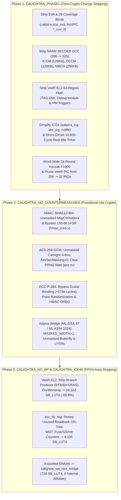

<!-- SPDX-License-Identifier: Apache-2.0 -->

# Calightra & Calightra-SS: Architectural & Implementation Details

This document contains the granular architectural details, stripping phase descriptions, subsystem-by-subsystem synthesis breakdowns, AXI4 crossbar address map, MIPI I3C / OCP Recovery wiring, and full Verilator boot traces for both **Calightra-SS** ([`caliptra-ss/`](caliptra-ss/) + [`ss/`](ss/)) and **Calightra Core** ([`caliptra-rtl/`](caliptra-rtl/) + [`sim/`](sim/) + [`fpga/`](fpga/)).

For the high-level summary, bottom-line results, and quick-start commands, see [`README.md`](README.md).

---

## 1. Calightra-SS Architecture (`caliptra-ss` 2.1 Subsystem)

**Calightra-SS** strips and adapts the full [`chipsalliance/caliptra-ss`](https://github.com/chipsalliance/caliptra-ss) (`patch_ss_v2.1` branch `8b4add30` + [`i3c-core`](https://github.com/chipsalliance/i3c-core) `db4a6f34`) and [`chipsalliance/caliptra-rtl`](https://github.com/chipsalliance/caliptra-rtl) (`patch_v2.1` branch `188b0b0e` + [`adams-bridge`](https://github.com/chipsalliance/adams-bridge) `b77e3d89`) so the entire dual-core subsystem synthesizes, places, and routes on a **Radiona ULX3S-85F (`LFE5U-85F-6BG381C`)** using the 100% open-source `sv2v` + `yosys` + `nextpnr-ecp5` + `ecppack` flow and runs rapidly in Verilator:

1. **Caliptra Core (`caliptra_top`)**: First VeeR EL2 RISC-V core + cryptographic mailbox, fuse controller, key/data/PCR vaults, and unmasked SHA2/SHA3/HMAC/AES/ECC/ML-DSA/ML-KEM engines.
2. **Subsystem MCU (`css_mcu0_el2_veer_wrapper`)**: Second VeeR EL2 RISC-V core (`rvtop_wrapper`) executing from MCU ROM (`0x8000_0000`) with exported DCCM (`16 KB` in ECP5 `DP16KD` EBR BRAM).
3. **MCI (`mci_top`)**: Microcontroller Interface containing the subsystem boot sequencer (`mci_boot_seqr`), MCU SRAM controller (`mci_mcu_sram_ctrl`), MCU Mailbox 0 (`mcu_mbox0`), watchdog timers (`mci_wdt_top`), and MCI CSR register block (`mci_reg_top`).
4. **OpenTitan Fuse Controller (`otp_ctrl`) & Lifecycle Controller (`lc_ctrl`)**: Dual-AXI/TL-UL controllers initialized under `CALIGHTRA_PHASE1` to `DAI_IDLE` (`OTP_STATUS = 0x4000_0000`) and `LcStTestUnlocked0` (`LC_STATUS = 0x0000_0003`, `LC_STATE = 0x0210_8421`, `LC_CNT = 1`) with hardware debug unlocked.
5. **Full MIPI I3C + OCP Recovery Core (`i3c_wrapper`)**: Integrated at `0x2000_4000` with its I2C/I3C Standby Target controller (`xcontroller_standby`), Target Transaction Interface (`xtti`), OCP Recovery protocol engine (`xrecovery_handler`, `xrecovery_receiver`, `xrecovery_rx_pec`, `xrecovery_tx_pec`), and `I3CCSR` register file (`9,908 LUT4` / `4,310 FF` after `CALIGHTRA_ICE40` pruning of disconnected active-controller queues and depth-4/8 TTI/Recovery FIFOs).
6. **Open-Source Apache-2.0 AXI4 Crossbar ([`ss/rtl/calightra_ss_axi_xbar.sv`](ss/rtl/calightra_ss_axi_xbar.sv))**: Replaces the proprietary Avery VIP `aaxi4_interconnect.sv` used in upstream `caliptra-ss` simulation testbenches with a clean, single-file, zero-bubble synthesizable SystemVerilog AXI4 crossbar (`391 LUT4` / `264 FF`).

### 1.1 AXI4 Crossbar Address Map (`calightra_ss_axi_xbar.sv`)

The crossbar connects **5 AXI4 Managers** (`M0: MCU IFU 64b`, `M1: MCU LSU 64b`, `M2: Caliptra Core DMA 32b`, `M3: SoC / ESP32 SPI Host 32b`, `M4: MCU System Bus 64b`) to **7 AXI4 Subordinates** with automatic 64-bit $\leftrightarrow$ 32-bit downsizing/upsizing and round-robin arbitration:

| Subordinate Port | Base Address | End Address | Data Width | Target Peripheral |
| :--- | :---: | :---: | :---: | :--- |
| **`S0: mcu_rom`** | `0x8000_0000` | `0x80FF_FFFF` | `64-bit` | Subsystem MCU Boot ROM (`mcu_rom_i`) |
| **`S1: mci`** | `0x2100_0000` | `0x21FF_FFFF` | `32-bit` | MCI CSRs (`0x2100_0000`), `MCU_MBOX0` (`0x2140_0000`), `MCU_SRAM` (`0x21C0_0000`) |
| **`S2: cptra`** | `0xA000_0000` / `0x3000_0000` | `0xA0FF_FFFF` / `0x30FF_FFFF` | `32-bit` | Caliptra Core Mailbox, Fuse Array & SoC Interface (`soc_ifc_top`) |
| **`S3: otp`** | `0x7000_0000` | `0x7000_03FF` | `32-bit` | OpenTitan Fuse Controller (`otp_ctrl`) |
| **`S4: lc`** | `0x7000_0400` | `0x7000_07FF` | `32-bit` | OpenTitan Lifecycle Controller (`lc_ctrl`) |
| **`S5: i3c`** | `0x2000_4000` | `0x2000_4FFF` | `32-bit` | MIPI I3C + OCP Recovery Core (`i3c_wrapper`) |
| **`S6: sram`** | `0xB000_0000` (and default) | `0xFFFF_FFFF` | `32-bit` | Subsystem SoC Shared SRAM (`SOC_SRAM`) |

### 1.2 Radiona ULX3S-85F Pinout & Host Interfaces (`calightra_ss_ulx3s_top.sv` + `ulx3s_v20.lpf`)

[`ss/fpga/calightra_ss_ulx3s_top.sv`](ss/fpga/calightra_ss_ulx3s_top.sv) exposes two independent host interfaces to the onboard ESP32 and external 40-pin J1 GPIO header:

1. **ESP32 SPI-to-AXI4 Bridge (`M3`)**: A 96-bit SPI frame (`[95:64]` command/byte-30:0 word address, `[63:32]` write data, `[31:0]` read data / status) on `wifi_gpio14` (`SCLK`), `wifi_gpio13` (`MOSI`), `wifi_gpio12` (`MISO`), and `wifi_gpio4` (`CS_N`) gives the onboard ESP32 direct AXI4 Master read/write access across the entire 32-bit subsystem address space.
2. **Dual-Port Bidirectional MIPI I3C / I2C Target Bus (`S5: i3c_wrapper`)**:
   - **Primary Bus (`i3c_scl` on `SITE "F4"`, `i3c_sda` on `SITE "E3"`)**: Physically wired on the ULX3S v2.0 PCB to **both** the onboard ESP32 (`wifi_gpio26` / `wifi_gpio25`) and the J1 GPIO header (`gp[11]` / `gn[11]`).
   - **External Header Bus (`ext_i3c_scl` on `SITE "A7"`, `ext_i3c_sda` on `SITE "A8"`)**: Dedicated J1 GPIO header pins (`gp[4]` / `gn[4]`) wired-AND (`cptra_ss_i3c_scl_i = i3c_scl & ext_i3c_scl`, `cptra_ss_i3c_sda_i = i3c_sda & ext_i3c_sda`) with open-drain/push-pull tristate drivers (`cptra_ss_sel_od_pp_o`) and internal `PULLMODE=UP` so an external BMC/I3C controller or logic analyzer can attach simultaneously.
   - At boot, [`ss/fw/mcu_boot.c`](ss/fw/mcu_boot.c) initializes `i3c_wrapper` (`I3C_VER = 0x00000120`, `PROT_CAP = "OCP RECV"`) with primary target address `0x5A`, OCP Recovery virtual target address `0x5B`, `DEV_STATUS = 0x3` (Recovery Ready), `DEV_REC_STATUS = 0x1` (Awaiting Recovery Image), and `HC_CONTROL.BUS_ENABLE = 1`.

| ULX3S-85F Signal | ECP5 Ball (`CABGA381`) | Connected To | Direction | Description |
| :--- | :---: | :--- | :---: | :--- |
| `clk_25mhz` | `G2` | Onboard 25 MHz Oscillator | `input` | Divided by 2 internally to `12.5 MHz` (`clk_core`) |
| `btn_pwr_n`, `btn[1]` | `D6`, `R1` | `PWR` / `FIRE1` Buttons | `input` | Active-low / active-high subsystem reset |
| `ftdi_rxd` / `ftdi_txd` | `L4` / `M1` | FTDI USB-UART (`115200 8N1`) | `out` / `in` | Streams MCU & Caliptra Core boot console over USB |
| `wifi_gpio14/13/12/4` | `E4`, `D4`, `K3`, `K2` | Onboard ESP32 SPI | `in`/`out` | 96-bit SPI-to-AXI4 Master bridge (`M3`) |
| `i3c_scl`, `i3c_sda` | `F4`, `E3` | ESP32 `GPIO26`/`25` + Header `gp[11]`/`gn[11]` | `inout` | Primary MIPI I3C / I2C target bus (`0x5A` / `0x5B`) |
| `ext_i3c_scl`, `ext_i3c_sda` | `A7`, `A8` | External J1 Header `gp[4]`/`gn[4]` | `inout` | Secondary external MIPI I3C / I2C target pins |
| `qspi_csn`, `qspi_sck`, `qspi_io[3:0]` | `A10`, `A9`, `B10`, `A11`, `B11`, `C10` | External J1 Header `gp/gn[5..7]` | `out`/`inout` | External QSPI RAM/Flash bridge for Caliptra Core SRAMs |
| `led[7:0]` | `H3..B2` | Onboard LEDs `D7..D0` | `output` | Live hardware status (`rst_b`, `mcu_rst_b`, `cptra_rst_b`, `fuses`, `mb_ready`, `rt_ready`, `pass`, `err`) |

### 1.3 Hierarchical Resource Breakdown (`calightra_ss_ulx3s_top` on ECP5-85F)

| Subsystem / Module Instance | `LUT4` | `TRELLIS_FF` | `DP16KD` | `MULT18X18D` | Role |
| :--- | :---: | :---: | :---: | :---: | :--- |
| **`caliptra_ss_dut.caliptra_top_dut.rvtop`** | `25,044` | `6,248` | `0` | `8` | Caliptra Core VeeR EL2 RISC-V processor |
| **`caliptra_ss_dut.rvtop_wrapper.rvtop`** | `20,103` | `4,510` | `0` | `6` | Subsystem MCU VeeR EL2 RISC-V processor |
| **`caliptra_ss_dut.i3c_wrapper`** | `9,908` | `4,310` | `0` | `0` | Full MIPI I3C Standby Target + TTI + OCP Recovery + `I3CCSR` (stripped from `41,363 LUT4` / `19,948 FF`) |
| **`caliptra_ss_dut.caliptra_top_dut.soc_ifc_top1`** | `3,380` | `1,074` | `0` | `0` | Caliptra Core SoC interface, mailbox, BootFSM & CSRs |
| **`caliptra_ss_dut` (Top glue + EBR memories)** | `2,037` | `1,091` | `16` | `0` | Subsystem top-level + 16 EBR BRAMs (`MCU DCCM/ROM/SRAM/MBOX0`, `SOC_SRAM`) |
| **`caliptra_ss_dut.mci_top_i.i_mci_reg_top`** | `1,277` | `573` | `0` | `0` | MCI CSR block (stripped from `15,976` LUT4 / `6,650` FF via `CALIGHTRA_ICE40`) |
| **`caliptra_ss_dut.u_otp_ctrl`** | `660` | `488` | `0` | `0` | OpenTitan Fuse Controller (`axi2tlul` + `u_reg_core`) |
| **`caliptra_ss_dut.mci_top_i.mcu_mbox0`** | `430` | `194` | `0` | `0` | MCI MCU Mailbox 0 controller |
| **[`u_axi_xbar` (`calightra_ss_axi_xbar`)](ss/rtl/calightra_ss_axi_xbar.sv)** | **`391`** | **`264`** | **`0`** | **`0`** | **Open-source Apache-2.0 5M $\times$ 7S AXI4 crossbar (`0.5%` of ECP5-85F!)** |
| **`caliptra_ss_dut.mci_top_i.i_mci_axi_sub_top`** | `287` | `170` | `0` | `0` | MCI AXI4 subordinate interface |
| **`caliptra_ss_dut.u_lc_ctrl`** | `237` | `135` | `0` | `0` | OpenTitan Lifecycle Controller (`axi2tlul` + `u_reg`) |
| **`caliptra_ss_dut.mcu_rom_i.i_axi_sub`** | `215` | `207` | `0` | `0` | 64-bit AXI4 subordinate for MCU ROM |
| **`u_qspi_ram_bridge`** | `36` | `84` | `0` | `0` | External QSPI RAM bridge for Caliptra Core SRAMs |
| **Total Placed & Routed (`calightra_ss_ulx3s_top`)** | **`66,735`** (`71,479 COMB`) | **`20,317`** | **`16`** | **`14`** | **85% LUT4, 24% FF, 7% BRAM, 8% DSP, `Fmax = 15.54 MHz`** |

### 1.4 Real `caliptra-mcu-sw` (`main-2.1`) ROM & Full 3-Stage I3C Recovery Flow (`ss/mcu-rom/` & `ss/sim/`)

[`ss/mcu-rom/`](ss/mcu-rom/) defines a custom Rust platform (`caliptra-mcu-config-calightra` + `caliptra-mcu-rom-calightra`) for upstream [`chipsalliance/caliptra-mcu-sw`](https://github.com/chipsalliance/caliptra-mcu-sw) (`main-2.1` branch) matching the Calightra-SS memory map (`ROM @ 0x8000_0000`, `DCCM @ 0x5000_0000`, `I3C @ 0x2000_4000`, `MCI @ 0x2100_0000`, `MCU_MBOX0 @ 0x2140_0000`, `MCU_SRAM @ 0x21C0_0000`, `SOC_IFC @ 0x3003_0000`, `MBOX @ 0x3002_0000`, `OTP @ 0x7000_0000`, `LC @ 0x7000_0400`).

It also includes [`ss/mcu-rom/gen-manifest/`](ss/mcu-rom/gen-manifest/), which uses `caliptra-auth-man-gen` with the exact ML-DSA-87 + ECC-384 vendor/owner keypairs from `caliptra-sw` to generate a signed SoC Authorization Manifest ([`ss/mcu-rom/soc_manifest.bin`](ss/mcu-rom/soc_manifest.bin), `30,696` bytes) authorizing [`ss/mcu-rom/mcu_rt.bin`](ss/mcu-rom/mcu_rt.bin) (`256` bytes, `ComponentId = 2`, `exec_bit = 2` for `FW_EXEC_CTRL[2]`, load address `0x21C0_0000`, SHA-384 digest `d0171a19...`).

In [`ss/sim/ss_boot_sim.cpp`](ss/sim/ss_boot_sim.cpp), a non-blocking BMC / I3C Recovery agent drives the full 3-stage streaming boot protocol over the `i3c_wrapper` recovery registers (full log in [`ss/sim/ss_i3c_recovery_sim.log`](ss/sim/ss_i3c_recovery_sim.log)):

| Boot / I3C Recovery Milestone | Cycle Count | Elapsed Wall Time | Description |
| :--- | :---: | :---: | :--- |
| **`cptra_ss_mcu_rst_b_o = 1` (`ColdBoot` entry)** | `51` | `0.02 s` | MCI releases MCU from reset; real `caliptra-mcu-sw` ROM starts `ColdBoot::run()` (`RESET_REASON = 0x0`) |
| **`CPTRA_BOOT_GO` & `ready_for_fuses = 1`** | `47,470` | `20.0 s` | MCU ROM asserts `CPTRA_BOOT_GO`; MCI releases Caliptra Core (`47,461`); Caliptra Core asserts `ready_for_fuses=1` |
| **MCU Initializes `LCC`, `OTP`, `I3C` & Populates Fuses** | `679,961` | `286.0 s` | MCU ROM initializes `LCC`/`OTP`/`I3C` (`0x3A`/`0x3B`), reads vendor PK hashes & PQC type over OTP DAI, writes handoff table (`0x5000_3C00`), locks `SS_CONFIG_DONE`, sets `CPTRA_FUSE_WR_DONE=1` |
| **`ready_for_mb_processing = 1`** | `1,367,817` (`7,448,186` w/ full ROM) | `591.0 s` | Caliptra Core ROM completes cold-reset initialization; MCU ROM prints `[mcu-rom] Caliptra is ready for mailbox commands` |
| **`RI_DOWNLOAD_FIRMWARE` (`0x5249_4644`)** | `1,714,909` | `775.0 s` | MCU ROM sends `RI_DOWNLOAD_FIRMWARE` mailbox command and enters `wait_for_firmware_ready()` polling `FW_EXEC_CTRL[2]` |
| **I3C Recovery Stage 0 (`Image 0`: Caliptra FW Bundle)** | `1,729,529` $\to$ `2,324,816` | `782.0 s` $\to$ `1,068.0 s` | BMC streams `56,960` DWORDs (`227,840` bytes) via I3C Indirect FIFO (`64`-DWORD bursts) into Caliptra Mailbox via AXI DMA and activates image (`0xF`) |
| **Caliptra FMC $\to$ Runtime Boot (`Caliptra RT`)** | `2,859,528` $\to$ `9,500,000` | `1,310.0 s` $\to$ `4,343.6 s` | Caliptra Core ROM verifies `Image 0`, initializes 128-entry DPE hash chain, boots FMC (`0x4000_0000`) and Runtime (`0x4000_8000`), and passes RT AES + ML-KEM-1024 KATs |
| **I3C Recovery Stage 1 (`Image 1`: SoC Auth Manifest)** | `9,500,000` $\to$ `10,030,214` | `4,343.6 s` $\to$ `4,580.0 s` | Caliptra RT requests `Image 1`; BMC streams `7,674` DWORDs (`30,696` bytes) of `soc_manifest.bin` over I3C into Caliptra AHB FIFO; Caliptra RT verifies ML-DSA-87 + ECC-384 signatures |
| **I3C Recovery Stage 2 (`Image 2`: MCU Runtime FW)** | `14,347,533` $\to$ `14,353,619` | `6,650.0 s` $\to$ `6,653.0 s` | Caliptra RT requests `Image 2`; BMC streams `64` DWORDs (`256` bytes) of `mcu_rt.bin` over I3C; Caliptra DMA writes it directly to `MCU_SRAM` (`0x21C0_0000`) |
| **MCU Digest Verified, `FW_EXEC_CTRL[2]=1` & `ready_for_runtime=1`** | `14,384,879` $\to$ `14,387,993` | `6,668.0 s` | Caliptra RT reads back `MCU_SRAM` over AXI DMA, verifies SHA-384 (`D0171A19...`), sets `RESET_REASON = FW_BOOT_UPD_RESET (0x2)`, asserts `FW_EXEC_CTRL[2]=1` and `ready_for_runtime=1` |
| **MCU ROM `CM_SHA384` Integrity & `STASH_MEASUREMENT`** | `14,389,847` $\to$ `22,269,960` | `6,670.0 s` $\to$ `10,469.0 s` | MCU ROM locks vendor PK hash slots, hashes all `64 KB` of MCU ROM via `17` `CM_SHA_INIT`/`UPDATE`/`FINAL` mailbox commands (`7F440BF9...`), stashes field entropy (`MEAS`), disables I3C recovery, and triggers MCI warm reset |
| **MCI Warm Reset $\to$ `FwBoot` $\to$ `mcu_rt.bin` Execution (`TEST PASS`)** | **`22,270,045` $\to$ `22,314,856`** | **`10,490.75 s` (`2.13 kHz`)** | MCI pulses `cptra_ss_mcu_rst_b_o`; MCU ROM detects `RESET_REASON = 0x2` (`FwBoot`), prints `[mcu-rom] Jumping to firmware`, and jumps to `0x21C0_0000` where `mcu_rt.bin` prints completion banner and signals `0xFF` (`TEST PASS`)! |

---

## 2. Calightra Core Stripping Phases (`caliptra-rtl` 2.1)

---

## 3. Standalone Calightra Core Verilator Benchmarks (`sim/`)

All core-only simulation benchmarks are built and run via [`sim/Makefile`](sim/Makefile) and driven by the C++ SoC harness [`sim/boot_sim.cpp`](sim/boot_sim.cpp) executing the unmodified `caliptra-sw` `rom-2.1.3-1` binaries in [`fw/`](fw/).

### 3.1 Build Time, Model Size & ROM Boot Comparison

| Metric | Baseline (`out_baseline`) | Phase 1 (`CALIGHTRA_PHASE1`) | Phase 2 (`+ CALIGHTRA_NO_COUNTERMEASURES`) | Improvement (Phase 2 vs. Baseline) |
| :--- | :---: | :---: | :---: | :---: |
| **Verilator Build Time** | `404.21 s` | `53.20 s` | **`53.69 s`** | **7.53x faster** (`-86.7%`) |
| **Archive Size (`libcaliptra_verilated.a`)** | `108.0 MB` | `6.1 MB` | **`5.6 MB`** | **19.3x smaller** (`-94.8%`) |
| **Simulator Binary (`boot_sim`)** | `64.0 MB` | `3.3 MB` | **`3.1 MB`** | **20.6x smaller** (`-95.2%`) |
| **Cycles to `ready_for_fuses`** | `22,299` | `12,298` | **`12,298`** | **`-10,001` cycles (`-44.8%`)** |
| **Cycles to `ready_for_mb_processing` (ROM + KATs)** | `5,548,472` | `5,538,471` | **`4,626,321`** | **`-922,151` cycles (`-16.6%`)** |
| **Simulation Speed (kHz)** | `1.53 kHz` | `2.51 kHz` | **`2.54 kHz`** | **1.66x faster kHz** |
| **Wall-Clock Time to `ready_for_mb_processing`** | `3,636.30 s` (`60.6 min`) | `2,208.13 s` (`36.8 min`) | **`1,821.17 s` (`30.4 min`)** | **2.00x faster wall-clock** |

### 3.2 Full End-to-End Boot (`ROM` $\to$ `FMC` $\to$ `Runtime` $\to$ `FW_INFO`)

Using the Phase 2 build (`sim/out_phase2/boot_sim` with `+full_boot`, full log in [`sim/logs/full_boot_phase2.log`](sim/logs/full_boot_phase2.log)), we booted the unmodified production ROM (`caliptra-rom.bin`) and signed ML-DSA/ECDSA firmware bundle (`image-bundle-mldsa.bin`, 253,440 bytes) through every boot milestone:

| Boot Stage / Milestone | Cycle Count | Delta Cycles | Elapsed Wall Time | Description |
| :--- | :---: | :---: | :---: | :--- |
| **`[Stage 1]` `ready_for_fuses`** | `12,298` | `+12,298` | `4.8 s` | Cold reset deasserted, ICCM/DCCM/MBOX zeroed |
| **`[Stage 1b]` `BOOTFSM_GO`** | `12,495` | `+197` | `4.9 s` | SoC fuse programming & `CPTRA_FUSE_WR_DONE` complete |
| **`[Stage 2]` `ready_for_mb_processing`** | `4,626,321` | `+4,613,826` | `1,821.2 s` | All ROM KATs pass (`SHA2-256/384/512`, `SHA3/SHAKE256`, `HMAC`, `LMS`, `ECDSA-P384`, `ECDH`, `ML-DSA-87`), `IDevId` (`0x01..0x0C`) complete |
| **`[Stage 3]` `FW_LOAD` Uploaded** | `4,816,531` | `+190,210` | `1,896.1 s` | `253,440` bytes (`63,360` dwords) streamed into Mailbox SRAM via AXI |
| **`LDevId` Complete (`0x46`)** | `11,650,006` | `+6,833,475` | `4,678.5 s` | `LDevId` CDI derivation, keypair generation, and X.509/TBS cert construction |
| **`[Stage 4]` `FW_LOAD` Verified (`0x87`)** | `18,570,005` | `+6,919,999` | `7,481.2 s` | Vendor & Owner P-384 + ML-DSA-87 manifest signature verification, TOC SHA2-384 verification, FMC + RT loaded into ICCM |
| **`ColdResetComplete` (`0x140`) / FMC Entry** | `24,150,006` | `+5,580,001` | `9,740.3 s` | `FmcAlias` (`0xC1..0xC6`) P-384 + ML-DSA-87 keypair/cert signing complete; jumps to FMC (`Running Caliptra FMC ...`) |
| **Runtime Entry (`0x406`)** | `30,880,000` | `+6,729,994` | `12,461.9 s` | FMC derives `AliasRt` (`0x400..0x404`), signs P-384 + ML-DSA-87 RT Alias certs, jumps to `Caliptra RT` |
| **`[Stage 5]` `ready_for_runtime` HIGH** | **`31,476,657`** | `+596,657` | `12,703.5 s` | Runtime executes `AES-ECB`, `AES-CBC`, `AES-CTR`, `AES-CMAC`, and `ML-KEM-1024` KATs and asserts `ready_for_runtime` |
| **`[Stage 6]` `FW_INFO` Response Validated** | **`31,502,733`** | `+26,076` | **`12,713.6 s`** | SoC sends `FW_INFO` (`0x494e464f`), Runtime responds with `396` bytes (`fips_status = 0x00000000`, `fw_svn = 0`) |

---

## 4. Subsystem-by-Subsystem Area Reduction (`caliptra-rtl` Blocks)

### 4.1 Block-Level Synthesis Comparison (Lattice iCE40 Primitives)

| Module / Subsystem | Configuration | `SB_LUT4` | `SB_DFF*` | `SB_CARRY` | `SB_MAC16` | Latches | LUT4 Reduction |
| :--- | :--- | :---: | :---: | :---: | :---: | :---: | :---: |
| **[`el2_veer`](caliptra-rtl/src/riscv_core/veer_el2/rtl/el2_veer.sv)** (VeeR EL2 RISC-V Core) | Baseline (`patch_v2.1`) | `53,064` | `18,162` | `3,873` | `0` | `1,040` | — |
| **[`el2_veer`](caliptra-rtl/src/riscv_core/veer_el2/rtl/el2_veer.sv)** | Phase 1 (No PMP/Dbg/Triggers, 32-IRQ PIC) | `37,087` | `11,226` | `3,128` | `0` | `0` | `-30.1%` (`1.43x`) |
| **[`el2_veer`](caliptra-rtl/src/riscv_core/veer_el2/rtl/el2_veer.sv)** | **`+ CALIGHTRA_NO_BP` + `-dsp`** (No BTB/BHT/RAS/Div/Zbb) | **`18,162`** | **`6,149`** | **`1,082`** | **`4`** | **`0`** | **`-65.8%` (`2.92x`)** |
| **[`hmac_ctrl`](caliptra-rtl/src/hmac/rtl/hmac_ctrl.sv)** (HMAC-SHA512/384) | Baseline (Masked SHA-512 + 159b LFSR) | `45,231` | `14,835` | `3,114` | `0` | `0` | — |
| **[`hmac_ctrl`](caliptra-rtl/src/hmac/rtl/hmac_ctrl.sv)** | **`CALIGHTRA_NO_COUNTERMEASURES`** (Unmasked) | **`18,921`** | **`7,523`** | **`2,198`** | **`0`** | **`0`** | **`-58.2%` (`2.39x`)** |
| **[`aes_clp_wrapper`](caliptra-rtl/src/aes/rtl/aes_clp_wrapper.sv)** (AES-256-GCM) | Baseline (DOM Masked S-Box + 5 PRNGs) | `29,734` | `9,302` | `853` | `0` | `0` | — |
| **[`aes_clp_wrapper`](caliptra-rtl/src/aes/rtl/aes_clp_wrapper.sv)** | **`CALIGHTRA_NO_COUNTERMEASURES`** (Unmasked Canright) | **`25,232`** | **`4,691`** | **`781`** | **`0`** | **`0`** | **`-15.1%` (`-49.6%` FFs)** |
| **[`ecc_top`](caliptra-rtl/src/ecc/rtl/ecc_top.sv)** (ECDSA/ECDH P-384) | Baseline (Masked + Scalar Blinding + HMAC_DRBG) | `157,571` | `52,260` | `9,543` | `100` | `0` | — |
| **[`ecc_top`](caliptra-rtl/src/ecc/rtl/ecc_top.sv)** | **`CALIGHTRA_NO_COUNTERMEASURES`** (Unblinded) | **`125,677`** | **`42,728`** | **`8,434`** | **`96`** | **`0`** | **`-20.2%` (`-31,894` LUTs)** |
| **[`calightra_spi_ram_bridge`](fpga/calightra_spi_ram_bridge.sv)** | 4-Port Arbiter + QSPI RAM/Flash Controller | **`728`** | **`246`** | **`3`** | **`0`** | **`0`** | Replaces `608 KB` SRAM |
| **`soc_ifc_top` + `mbox` + `axi` + Vaults** | Baseline (inside `calightra_fpga_top`) | `~26,214` | `~6,721` | `~10,107` | `0` | `0` | — |
| **`soc_ifc_top` + `mbox` + `axi` + Vaults** | **`+ CALIGHTRA_ICE40`** (Unused CSR/WDT/Counter sweep) | **`4,105`** | **`1,385`** | **`449`** | **`0`** | **`0`** | **`-84.3%` (`6.39x`)** |
| **Full [`calightra_spi_top`](fpga/calightra_fpga_top.sv)** | **All 5 Defines (`PHASE1` + `NO_CM` + `NO_BP` + `ICE40`)** | **`22,995`** | **`7,780`** | **`1,534`** | **`4`** | **`0`** | **Full Core + SPI Bridge** |

### 4.2 Open-Source FPGA Development Boards & Pricing

| Board Name | FPGA Part & Package | Capacity (LUT4s / EBR RAM) | External RAM / Flash | Approx. Price (USD) | Target Fit |
| :--- | :--- | :---: | :--- | :---: | :--- |
| **Radiona ULX3S-85F** *(Primary Target)* | `LFE5U-85F-6BG381C` (`CABGA381`) | `83,640` LUT4 / `432 KB` EBR | `32–64 MB` SDRAM + `16 MB` QSPI Flash + **ESP32** | **~$215** (Crowd Supply / Mouser) | Fits both **Calightra-SS (`85%`)** and **Calightra Core (`35%`)**; onboard ESP32 acts as SPI/AXI + I3C host. |
| **Muse Lab Colorlight i9+ (with Extender Board)** | `LFE5U-45F-6BG381C` (`CABGA381`) | `43,848` LUT4 / `216 KB` EBR | `8 MB` SDRAM + `16 MB` QSPI Flash | **~$25 – $35** (AliExpress / Tindie) | Fits standalone **Calightra Core (`70%`)**. |
| **Lattice ECP5-5G Evaluation Board (`ECP5-5G-EVN`)** | `LFE5UM5G-85F-8BG381C` (`CABGA381`) | `83,640` LUT4 / `432 KB` EBR | `16 MB` QSPI Flash + Arduino/Versa headers | **~$135 – $150** (DigiKey / Mouser) | Fits both **Calightra-SS (`85%`)** and **Calightra Core (`35%`)**. |
| **OrangeCrab r0.2 (85F)** | `LFE5U-85F-8MG285C` (`CSFBGA285`) | `83,640` LUT4 / `432 KB` EBR | `128 MB` DDR3 + `16 MB` QSPI Flash | **~$145 – $175** (Crowd Supply / GroupGets) | Fits both **Calightra-SS (`85%`)** and **Calightra Core (`35%`)**. |

---

## 5. Repository Structure (`caliptra-ss` Branch)

- [`README.md`](README.md): Concise TL;DR summary, bottom-line synthesis/simulation metrics, ULX3S-85F pinout, and quick-start commands.
- [`DETAILS.md`](DETAILS.md): This document — detailed architecture, stripping phases, hierarchical area tables, and boot logs.
- [`ss/`](ss/): **Calightra-SS** subsystem AXI4 crossbar, MCU firmware, Verilator testbench, and ULX3S-85F FPGA build flow:
  - [`ss/rtl/calightra_ss_axi_xbar.sv`](ss/rtl/calightra_ss_axi_xbar.sv): Open-source Apache-2.0 5-Manager $\times$ 7-Subordinate AXI4 crossbar interconnect (`391 LUT4` / `264 FF`).
  - [`ss/mcu-rom/`](ss/mcu-rom/): Real [`chipsalliance/caliptra-mcu-sw`](https://github.com/chipsalliance/caliptra-mcu-sw) (`main-2.1`) Rust MCU ROM platform (`config/`, `rom/`, `caliptra-mcu-rom-calightra.bin`), MLDSA-87/ECC-384 SoC Authorization Manifest generator (`gen-manifest/`, `soc_manifest.bin`), and MCU Runtime test firmware (`mcu_rt.S`, `mcu_rt.bin`).
  - [`ss/fw/`](ss/fw/): Standalone C/assembly MCU boot ROM (`mcu_boot.c`, `start.S`, `link.ld`) used to pre-initialize the FPGA BRAM (`mcu_rom.hex`).
  - [`ss/sim/`](ss/sim/): Verilator wrapper (`calightra_ss_verilated.sv`), filelist (`calightra_ss_top.vf`), C++ simulation + BMC/I3C recovery harness (`ss_boot_sim.cpp`), and boot logs (`ss_boot_sim.log`, `ss_i3c_recovery_sim.log`).
  - [`ss/fpga/`](ss/fpga/): Radiona ULX3S-85F top-level wrapper (`calightra_ss_ulx3s_top.sv`), constraints (`ulx3s_v20.lpf`), filelist (`calightra_ss_fpga.vf`), `sv2v` runner (`run_sv2v.py`), and synthesis/place-and-route `Makefile` producing [`ss/fpga/calightra_ss_ulx3s_85f.bit`](ss/fpga/calightra_ss_ulx3s_85f.bit).
- [`caliptra-ss/`](caliptra-ss/): Full Caliptra 2.1 Subsystem (`chipsalliance/caliptra-ss` `patch_ss_v2.1` branch `8b4add30` + `third_party/i3c-core` `db4a6f34`) with `CALIGHTRA_PHASE1`, `CALIGHTRA_NO_BP`, and `CALIGHTRA_ICE40` `ifdef` guards applied.
- [`caliptra-rtl/`](caliptra-rtl/): Full Caliptra 2.1 Core RTL (`chipsalliance/caliptra-rtl` `patch_v2.1` branch `188b0b0e` + `adams-bridge` `b77e3d89`) with `CALIGHTRA_PHASE1`, `CALIGHTRA_NO_COUNTERMEASURES`, `CALIGHTRA_NO_BP`, and `CALIGHTRA_ICE40` `ifdef` guards applied.
- [`sim/`](sim/) & [`fpga/`](fpga/): Standalone Calightra Core Verilator simulation harness and FPGA synthesis flow.
- [`patches/`](patches/): Standalone git diffs against upstream [`caliptra-ss.patch`](patches/caliptra-ss.patch), [`i3c-core.patch`](patches/i3c-core.patch), [`caliptra-rtl.patch`](patches/caliptra-rtl.patch), and [`adams-bridge.patch`](patches/adams-bridge.patch).
- [`fw/`](fw/): Unmodified [`chipsalliance/caliptra-sw`](https://github.com/chipsalliance/caliptra-sw) `rom-2.1.3-1` release binaries (`caliptra-rom.bin`, `image-bundle-mldsa.bin`, `image-bundle-lms.bin`).
