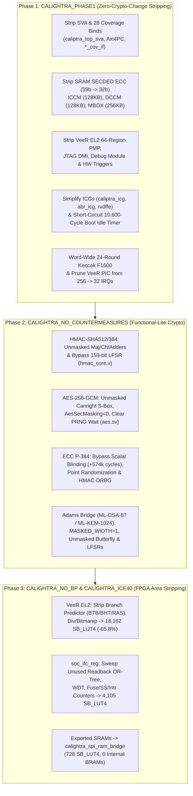

# Calightra: Stripping Caliptra 2.1 RTL for Fast Verilator Simulation & Small Open-Source FPGAs

**Calightra** is a stripped-down, 100% binary-compatible implementation of [`chipsalliance/caliptra-rtl`](https://github.com/chipsalliance/caliptra-rtl) (`patch_v2.1` branch, `188b0b0e` + `adams-bridge` `v2.0.3` `b77e3d89`) designed for:
1. **High-Speed Verilator Simulation**: **7.53x faster** compilation (`404.2s` $\to$ `53.7s`), **19.3x smaller** model (`108 MB` $\to$ `5.6 MB`), and **2.00x faster** wall-clock boot of the unmodified production [`chipsalliance/caliptra-sw`](https://github.com/chipsalliance/caliptra-sw) 2.1 release binaries (`rom-2.1.3-1`: `caliptra-rom.bin` + `image-bundle-mldsa.bin` containing FMC and Runtime `fw-2.1.4`).
2. **Small Open-Source Toolchains & FPGAs (`sv2v` + `yosys` + `nextpnr-ice40` / `nextpnr-ecp5`)**: Stripping side-channel countermeasures (DOM masking, scalar blinding, LFSRs), SRAM SECDED ECC (`39b` $\to$ `32b`), VeeR EL2 branch predictors/PMP/debug/triggers, and unused CSR readback trees, while bridging all 608 KB of SRAM/ROM over an external QSPI RAM/Flash controller (`calightra_spi_ram_bridge.sv`, `728 LUT4` / `0 BRAMs`).

---

## 1. Executive Summary

1. **Verilator Build & Simulation Speedup (`CALIGHTRA_PHASE1` + `CALIGHTRA_NO_COUNTERMEASURES`)**:
   - **Verilator Build Time**: Reduced from **404.21 s** to **53.69 s** (**7.53x faster**).
   - **Verilated Library Size**: Reduced from **108.0 MB** to **5.6 MB** (**19.3x smaller**).
   - **ROM Boot (`cycle 0` $\to$ `ready_for_mb_processing`)**: Reduced from **5,548,472 cycles** (`3,636.30 s` @ `1.53 kHz`) to **4,626,321 cycles** (`1,821.17 s` @ `2.54 kHz`) — saving **922,151 cycles (-16.6%)** and running **2.00x faster in wall-clock time**.
   - **100% Binary-Compatible Full End-to-End Boot (`ROM` $\to$ `FMC` $\to$ `Runtime` $\to$ `FW_INFO`)**: Verified cold-reset boot of the unmodified `caliptra-rom.bin` (`rom-2.1.3`) and `image-bundle-mldsa.bin` (`fw-2.1.4`) all the way through ROM KATs, 3 DICE layers (`IDevId`, `LDevId`, `FmcAlias`), `FW_LOAD` authentication & load (P-384 ECDSA + ML-DSA-87 + SHA2-384/512 + SHA3/SHAKE256), FMC execution (`AliasRt`), Runtime KATs (`AES-ECB/CBC/CTR/CMAC`, `ML-KEM-1024`), `ready_for_runtime` (**cycle 31,476,657**), and mailbox `FW_INFO` command/response (**cycle 31,502,733**, returning 396 bytes with `fips_status = 0x00000000`).

2. **Open-Source FPGA Synthesis & Place-and-Route (`sv2v` + `yosys` + `nextpnr-ice40` / `nextpnr-ecp5`)**:
   - **VeeR EL2 RISC-V Core ([`el2_veer.sv`](caliptra-rtl/src/riscv_core/veer_el2/rtl/el2_veer.sv))**: Stripped from **53,064 `SB_LUT4`** and **18,162 `SB_DFF*`** (plus 1,040 latches) down to **18,162 `SB_LUT4` (-65.8% / 2.92x smaller)**, **6,149 `SB_DFF*` (-66.1% / 2.95x smaller)**, **4 `SB_MAC16`**, and **0 latches**.
   - **Exported ECC-Free SRAMs + External QSPI RAM Bridge ([`calightra_spi_ram_bridge.sv`](fpga/calightra_spi_ram_bridge.sv))**: Stripped all SECDED ECC bits (`39b` $\to$ `32b`) from ICCM (128 KB), DCCM (128 KB), and Mailbox SRAM (256 KB), and built a **728 `SB_LUT4` / 246 `SB_DFF*`** QSPI RAM/Flash arbiter-serializer bridge that maps the entire 608 KB memory space (96 KB ROM + 128 KB ICCM + 128 KB DCCM + 256 KB Mailbox SRAM) over a 6-pin external QSPI interface using **0 internal FPGA BRAMs**.
   - **Crypto Countermeasure Stripping (`CALIGHTRA_NO_COUNTERMEASURES`)**:
     - **[`hmac_ctrl`](caliptra-rtl/src/hmac/rtl/hmac_ctrl.sv)** (SHA-512/384): **45,231 $\to$ 18,921 `SB_LUT4` (-58.2% / 2.39x smaller)**, **14,835 $\to$ 7,523 `SB_DFF*` (-49.3%)**.
     - **[`aes_clp_wrapper`](caliptra-rtl/src/aes/rtl/aes_clp_wrapper.sv)** (DOM Masked $\to$ Unmasked Canright S-Box): **29,734 $\to$ 25,232 `SB_LUT4` (-15.1%)**, **9,302 $\to$ 4,691 `SB_DFF*` (-49.6%)**.
     - **[`ecc_top`](caliptra-rtl/src/ecc/rtl/ecc_top.sv)** (P-384 without `hmac_drbg` / scalar blinding): **157,571 $\to$ 125,677 `SB_LUT4` (-20.2%, -31,894 LUT4s)**, **52,260 $\to$ 42,728 `SB_DFF*` (-18.2%)**.
   - **Full-Chip Ultra-Lite Core ([`calightra_spi_top`](fpga/calightra_fpga_top.sv))**:
     - **Lattice iCE40 (`synth_ice40 -dsp`)**: **22,995 `SB_LUT4`**, **7,780 `SB_DFF*`**, **1,534 `SB_CARRY`**, **4 `SB_MAC16`**, **0 BRAMs** (down from >600,000 LUT4s for unstripped Caliptra 2.1).
     - **Lattice ECP5-45F (`LFE5U-45F`, `CABGA381`) Placed & Routed (`nextpnr-ecp5`)**: **30,830 / 43,848 `TRELLIS_COMB` (70%)**, **7,782 / 43,848 `TRELLIS_FF` (17%)**, **8 / 72 `MULT18X18D` (11%)**, **0 / 5,481 `TRELLIS_RAMW` (0%)**, **151 / 245 `TRELLIS_IO` (61%)**, achieving **`Fmax = 16.86 MHz`** (passing the 12.00 MHz constraint).

---

## 2. Architecture & Stripping Phases



---

## 3. Verilator Build & Simulation Benchmark Results

All simulation benchmarks are built and run via [`sim/Makefile`](sim/Makefile) and driven by the C++ SoC harness [`sim/boot_sim.cpp`](sim/boot_sim.cpp) executing the unmodified `caliptra-sw` `rom-2.1.3-1` binaries in [`fw/`](fw/).

### 3.1 Build Time, Model Size & ROM Boot Comparison

| Metric | Baseline (`out_baseline`) | Phase 1 (`CALIGHTRA_PHASE1`) | Phase 2 (`+ CALIGHTRA_NO_COUNTERMEASURES`) | Improvement (Phase 2 vs. Baseline) |
| :--- | :---: | :---: | :---: | :---: |
| **Verilator Build Time** | `404.21 s` | `53.20 s` | **`53.69 s`** | **7.53x faster** (`-86.7%`) |
| **Archive Size (`libcaliptra_verilated.a`)** | `108.0 MB` | `6.1 MB` | **`5.6 MB`** | **19.3x smaller** (`-94.8%`) |
| **Simulator Binary (`boot_sim`)** | `64.0 MB` | `3.3 MB` | **`3.1 MB`** | **20.6x smaller** (`-95.2%`) |
| **Cycles to `ready_for_fuses`** | `22,299` | `12,298` | **`12,298`** | **`-10,001` cycles (`-44.8%`)** |
| **Cycles to `ready_for_mb_processing` (ROM + KATs)** | `5,548,472` | `5,538,471` | **`4,626,321`** | **`-922,151` cycles (`-16.6%`)** |
| **Simulation Speed (kHz)** | `1.53 kHz` | `2.51 kHz` | **`2.54 kHz`** | **1.66x faster kHz** |
| **Wall-Clock Time to `ready_for_mb_processing`** | `3,636.30 s` (`60.6 min`) | `2,208.13 s` (`36.8 min`) | **`1,821.17 s` (`30.4 min`)** | **2.00x faster wall-clock** |

### 3.2 Full End-to-End Boot (`ROM` $\to$ `FMC` $\to$ `Runtime` $\to$ `FW_INFO`)

Using the Phase 2 build (`sim/out_phase2/boot_sim` with `+full_boot`, full log in [`sim/logs/full_boot_phase2.log`](sim/logs/full_boot_phase2.log)), we booted the unmodified production ROM (`caliptra-rom.bin`) and signed ML-DSA/ECDSA firmware bundle (`image-bundle-mldsa.bin`, 253,440 bytes) through every boot milestone:

| Boot Stage / Milestone | Cycle Count | Delta Cycles | Elapsed Wall Time | Description |
| :--- | :---: | :---: | :---: | :--- |
| **`[Stage 1]` `ready_for_fuses`** | `12,298` | `+12,298` | `4.8 s` | Cold reset deasserted, ICCM/DCCM/MBOX zeroed |
| **`[Stage 1b]` `BOOTFSM_GO`** | `12,495` | `+197` | `4.9 s` | SoC fuse programming & `CPTRA_FUSE_WR_DONE` complete |
| **`[Stage 2]` `ready_for_mb_processing`** | `4,626,321` | `+4,613,826` | `1,821.2 s` | All ROM KATs pass (`SHA2-256/384/512`, `SHA3/SHAKE256`, `HMAC`, `LMS`, `ECDSA-P384`, `ECDH`, `ML-DSA-87`), `IDevId` (`0x01..0x0C`) complete |
| **`[Stage 3]` `FW_LOAD` Uploaded** | `4,816,531` | `+190,210` | `1,896.1 s` | `253,440` bytes (`63,360` dwords) streamed into Mailbox SRAM via AXI |
| **`LDevId` Complete (`0x46`)** | `11,650,006` | `+6,833,475` | `4,678.5 s` | `LDevId` CDI derivation, keypair generation, and X.509/TBS cert construction |
| **`[Stage 4]` `FW_LOAD` Verified (`0x87`)** | `18,570,005` | `+6,919,999` | `7,481.2 s` | Vendor & Owner P-384 + ML-DSA-87 manifest signature verification, TOC SHA2-384 verification, FMC + RT loaded into ICCM |
| **`ColdResetComplete` (`0x140`) / FMC Entry** | `24,150,006` | `+5,580,001` | `9,740.3 s` | `FmcAlias` (`0xC1..0xC6`) P-384 + ML-DSA-87 keypair/cert signing complete; jumps to FMC (`Running Caliptra FMC ...`) |
| **Runtime Entry (`0x406`)** | `30,880,000` | `+6,729,994` | `12,461.9 s` | FMC derives `AliasRt` (`0x400..0x404`), signs P-384 + ML-DSA-87 RT Alias certs, jumps to `Caliptra RT` |
| **`[Stage 5]` `ready_for_runtime` HIGH** | **`31,476,657`** | `+596,657` | `12,703.5 s` | Runtime executes `AES-ECB`, `AES-CBC`, `AES-CTR`, `AES-CMAC`, and `ML-KEM-1024` KATs and asserts `ready_for_runtime` |
| **`[Stage 6]` `FW_INFO` Response Validated** | **`31,502,733`** | `+26,076` | **`12,713.6 s`** | SoC sends `FW_INFO` (`0x494e464f`), Runtime responds with `396` bytes (`fips_status = 0x00000000`, `fw_svn = 0`) |

---

## 4. Open-Source FPGA Synthesis & Place-and-Route Results

The automated `sv2v` + `yosys` + `nextpnr` flow lives in [`fpga/`](fpga/):
- [`fpga/Makefile`](fpga/Makefile): One-command synthesis and place-and-route targets (`make -C fpga ice40`, `make -C fpga pnr-ecp5`, `make -C fpga blocks`).
- [`fpga/run_sv2v.py`](fpga/run_sv2v.py): Parses [`fpga/calightra_ice40.vf`](fpga/calightra_ice40.vf), resolves include paths and package ordering, and runs `sv2v` with configurable `--define` flags.
- [`fpga/synth_blocks.py`](fpga/synth_blocks.py): Runs baseline vs. stripped Yosys synthesis (`synth_ice40 -dsp`) on individual Caliptra subsystems.
- [`fpga/calightra_spi_ram_bridge.sv`](fpga/calightra_spi_ram_bridge.sv): Bridges the exported ECC-free ICCM (8 banks $\times$ 16 KB), DCCM (8 banks $\times$ 16 KB), Mailbox SRAM (256 KB), and IMEM/ROM (96 KB) interfaces into a single external QSPI PSRAM/Flash interface.
- [`fpga/calightra_fpga_top.sv`](fpga/calightra_fpga_top.sv): Provides both `calightra_fpga_top` (with exported parallel SRAM ports) and `calightra_spi_top` (integrating `calightra_fpga_top` + `calightra_spi_ram_bridge` into a 151-pin top-level package).

### 4.1 Subsystem-by-Subsystem Area Reduction (Lattice iCE40 Primitives)

| Module / Subsystem | Configuration | `SB_LUT4` | `SB_DFF*` | `SB_CARRY` | `SB_MAC16` | Latches | LUT4 Reduction |
| :--- | :--- | :---: | :---: | :---: | :---: | :---: | :---: |
| **[`el2_veer`](caliptra-rtl/src/riscv_core/veer_el2/rtl/el2_veer.sv)** (VeeR EL2 RISC-V Core) | Baseline (`patch_v2.1`) | `53,064` | `18,162` | `3,873` | `0` | `1,040` | — |
| **[`el2_veer`](caliptra-rtl/src/riscv_core/veer_el2/rtl/el2_veer.sv)** | Phase 1 (No PMP/Dbg/Triggers, 32-IRQ PIC) | `37,087` | `11,226` | `3,128` | `0` | `0` | `-30.1%` (`1.43x`) |
| **[`el2_veer`](caliptra-rtl/src/riscv_core/veer_el2/rtl/el2_veer.sv)** | **`+ CALIGHTRA_NO_BP` + `-dsp`** (No BTB/BHT/RAS/Div/Zbb) | **`18,162`** | **`6,149`** | **`1,082`** | **`4`** | **`0`** | **`-65.8%` (`2.92x`)** |
| **[`hmac_ctrl`](caliptra-rtl/src/hmac/rtl/hmac_ctrl.sv)** (HMAC-SHA512/384) | Baseline (Masked SHA-512 + 159b LFSR) | `45,231` | `14,835` | `3,114` | `0` | `0` | — |
| **[`hmac_ctrl`](caliptra-rtl/src/hmac/rtl/hmac_ctrl.sv)** | **`CALIGHTRA_NO_COUNTERMEASURES`** (Unmasked) | **`18,921`** | **`7,523`** | **`2,198`** | **`0`** | **`0`** | **`-58.2%` (`2.39x`)** |
| **[`aes_clp_wrapper`](caliptra-rtl/src/aes/rtl/aes_clp_wrapper.sv)** (AES-256-GCM) | Baseline (DOM Masked S-Box + 5 PRNGs) | `29,734` | `9,302` | `853` | `0` | `0` | — |
| **[`aes_clp_wrapper`](caliptra-rtl/src/aes/rtl/aes_clp_wrapper.sv)** | **`CALIGHTRA_NO_COUNTERMEASURES`** (Unmasked Canright) | **`25,232`** | **`4,691`** | **`781`** | **`0`** | **`0`** | **`-15.1%` (`-49.6%` FFs)** |
| **[`ecc_top`](caliptra-rtl/src/ecc/rtl/ecc_top.sv)** (ECDSA/ECDH P-384) | Baseline (Masked + Scalar Blinding + HMAC_DRBG) | `157,571` | `52,260` | `9,543` | `100` | `0` | — |
| **[`ecc_top`](caliptra-rtl/src/ecc/rtl/ecc_top.sv)** | **`CALIGHTRA_NO_COUNTERMEASURES`** (Unblinded) | **`125,677`** | **`42,728`** | **`8,434`** | **`96`** | **`0`** | **`-20.2%` (`-31,894` LUTs)** |
| **[`calightra_spi_ram_bridge`](fpga/calightra_spi_ram_bridge.sv)** | 4-Port Arbiter + QSPI RAM/Flash Controller | **`728`** | **`246`** | **`3`** | **`0`** | **`0`** | Replaces `608 KB` SRAM |
| **`soc_ifc_top` + `mbox` + `axi` + Vaults** | Baseline (inside `calightra_fpga_top`) | `~26,214` | `~6,721` | `~10,107` | `0` | `0` | — |
| **`soc_ifc_top` + `mbox` + `axi` + Vaults** | **`+ CALIGHTRA_ICE40`** (Unused CSR/WDT/Counter sweep) | **`4,105`** | **`1,385`** | **`449`** | **`0`** | **`0`** | **`-84.3%` (`6.39x`)** |
| **Full [`calightra_spi_top`](fpga/calightra_fpga_top.sv)** | **All 5 Defines (`PHASE1` + `NO_CM` + `NO_BP` + `ICE40`)** | **`22,995`** | **`7,780`** | **`1,534`** | **`4`** | **`0`** | **Full Core + SPI Bridge** |

### 4.2 Full-Chip Synthesis & Place-and-Route on Lattice ECP5 (`nextpnr-ecp5`)

Synthesizing [`calightra_spi_top`](fpga/calightra_fpga_top.sv) with `yosys synth_ecp5` and running full timing-driven placement and routing with `nextpnr-ecp5 --45k --package CABGA381` (full log in [`fpga/logs/nextpnr_spi_top_ecp5.log`](fpga/logs/nextpnr_spi_top_ecp5.log)):

| Resource / Metric | Used | Available (`LFE5U-45F-CABGA381`) | Utilization | Notes |
| :--- | :---: | :---: | :---: | :--- |
| **`TRELLIS_COMB` (LUT4 / Carry)** | **`30,830`** | `43,848` | **`70%`** | Includes `29,148 LUT4` + `696 CCU2C` (`1,392` carry cells) |
| **`TRELLIS_FF` (Flip-Flops)** | **`7,782`** | `43,848` | **`17%`** | Zero latches (`0 DLATCH`) |
| **`MULT18X18D` (18x18 DSPs)** | **`8`** | `72` | **`11%`** | Used by VeeR EL2 `el2_exu_mul_ctl` |
| **`TRELLIS_RAMW` / `DP16KD` (BRAM)** | **`0`** | `5,481` (`108` EBRs) | **`0%`** | All 608 KB memory mapped via `calightra_spi_ram_bridge` |
| **`TRELLIS_IO` (I/O Pins)** | **`151`** | `245` | **`61%`** | Compact AXI4-Lite + 6-pin QSPI RAM + UART + status |
| **Placed & Routed `Fmax`** | **`16.86 MHz`** | `12.00 MHz` (target) | **PASS** | Single global clock domain (`$glbnet$clk$TRELLIS_IO_IN`) |

---

## 5. Recommended Open-Source FPGA Development Boards & Pricing

Because `calightra_spi_top` places and routes cleanly into **`30,830 TRELLIS_COMB` (`70%` of an `LFE5U-45F`)** with **0 internal BRAMs required** (or can use the `LFE5U-45F`/`85F`'s built-in 216 KB–432 KB EBR block RAM + onboard QSPI Flash / SDRAM), any **Lattice ECP5-45F (`LFE5U-45F`)** or **ECP5-85F (`LFE5U-85F`)** board works out of the box with the 100% open-source `sv2v` + `yosys` + `nextpnr-ecp5` + `ecppack` (`prjtrellis`) toolchain:

| Board Name | FPGA Part & Package | Capacity (LUT4s / EBR RAM) | External RAM / Flash | Approx. Price (USD) | Why It Fits Well |
| :--- | :--- | :---: | :--- | :---: | :--- |
| **Muse Lab Colorlight i9+ (with Extender Board)** | `LFE5U-45F-6BG381C` (`CABGA381`) | `43,848` LUT4 / `216 KB` EBR | `8 MB` SDRAM + `16 MB` QSPI Flash | **~$25 – $35** (AliExpress / Tindie) | Lowest-cost board using the exact `LFE5U-45F-CABGA381` chip & package verified above (`70%` utilization). |
| **Radiona ULX3S (45F or 85F)** | `LFE5U-45F-6BG381C` or `LFE5U-85F-6BG381C` | `43,848` or `83,640` LUT4 / up to `432 KB` EBR | `32–64 MB` SDRAM + `16 MB` QSPI Flash + **ESP32** | **~$155 (45F)** / **~$215 (85F)** (Crowd Supply / Mouser) | Flagship OSHW ECP5 board; onboard **ESP32** can act as the SoC AXI/Mailbox host and stream firmware over SPI/JTAG. |
| **Lattice ECP5-5G Evaluation Board (`ECP5-5G-EVN`)** | `LFE5UM5G-85F-8BG381C` (`CABGA381`) | `83,640` LUT4 / `432 KB` EBR | `16 MB` QSPI Flash + Arduino/Versa headers | **~$135 – $150** (DigiKey / Mouser) | Official Lattice evaluation board in stock at major distributors; `85F` has room to bring back unmasked hardware SHA/AES/ECC blocks alongside the core. |
| **OrangeCrab r0.2 (85F)** | `LFE5U-85F-8MG285C` (`CSFBGA285`) | `83,640` LUT4 / `432 KB` EBR | `128 MB` DDR3 + `16 MB` QSPI Flash | **~$145 – $175** (Crowd Supply / GroupGets) | Feather form-factor OSHW board with native USB bootloader. |
| **Colorlight i5 / iCESugar-Pro (25F)** *(with Vaults in EBR)* | `LFE5U-25F-6BG256C` / `CABGA381` | `24,288` LUT4 / `112 KB` EBR | `8–32 MB` SDRAM + `16 MB` QSPI Flash | **~$20 – $40** | Mapping `kv`/`pv`/`dv` flip-flop banks into `DP16KD` EBRs drops logic under `20k` LUT4s to fit on `25F` boards. |

---

## 6. Reproducing the Builds & Benchmarks

### Prerequisites (Ubuntu / Debian)
```bash
sudo apt-get install -y verilator yosys nextpnr-ice40 nextpnr-ecp5 fpga-icestorm fpga-trellis ccache
# Plus sv2v (https://github.com/zachjs/sv2v/releases) in PATH
```

### 6.1 Running Verilator Simulation (`sim/`)
```bash
# 1. Build Phase 2 Verilator simulator (~53 seconds)
make -C sim phase2

# 2. Run ROM boot + KATs to ready_for_mb_processing (4,626,321 cycles)
make -C sim run-phase2

# 3. Run full end-to-end boot: ROM -> FMC -> Runtime -> FW_INFO (31,502,733 cycles)
make -C sim run-full-phase2
```

### 6.2 Running Open-Source FPGA Synthesis & Place-and-Route (`fpga/`)
```bash
# 1. Convert SystemVerilog RTL to Verilog-2005 and synthesize for Lattice iCE40 (22,995 SB_LUT4)
make -C fpga ice40

# 2. Synthesize, place, and route calightra_spi_top on Lattice ECP5-45F (70% utilization, 16.86 MHz Fmax)
make -C fpga pnr-ecp5

# 3. Run baseline vs. stripped synthesis comparison on individual blocks (el2_veer, hmac_ctrl, aes, ecc_top)
make -C fpga blocks
```

---

## 7. Repository Structure

- [`README.md`](README.md): Project overview, architecture, benchmarks, and board guide.
- [`sim/`](sim/): Verilator build system and C++ SoC/AXI/Mailbox/Fuse simulation harness.
  - [`sim/Makefile`](sim/Makefile): Build targets for `baseline`, `phase1`, and `phase2`.
  - [`sim/boot_sim.cpp`](sim/boot_sim.cpp): C++ testbench driving cold reset, fuses, `FW_LOAD`, and `FW_INFO`.
  - [`sim/calightra_top.vf`](sim/calightra_top.vf): Stripped Verilator filelist removing SVA assertions and coverage binds.
  - [`sim/caliptra_verilated.sv`](sim/caliptra_verilated.sv): Top-level Verilator wrapper with exported ECC-free 32-bit SRAMs.
  - [`sim/logs/full_boot_phase2.log`](sim/logs/full_boot_phase2.log): Complete log of the 31.5M-cycle `ROM -> FMC -> Runtime -> FW_INFO` boot.
- [`fpga/`](fpga/): Open-source FPGA synthesis (`sv2v` + `yosys`) and place-and-route (`nextpnr`) flow.
  - [`fpga/Makefile`](fpga/Makefile): Build targets for `ice40`, `ecp5`, `pnr-ecp5`, and `blocks`.
  - [`fpga/calightra_fpga_top.sv`](fpga/calightra_fpga_top.sv): Synthesizable `calightra_fpga_top` and pin-reduced `calightra_spi_top` wrappers.
  - [`fpga/calightra_spi_ram_bridge.sv`](fpga/calightra_spi_ram_bridge.sv): 4-port priority arbiter and QSPI RAM/Flash controller (`728 SB_LUT4`).
  - [`fpga/calightra_ice40.vf`](fpga/calightra_ice40.vf): Synthesizable filelist for `sv2v`.
  - [`fpga/run_sv2v.py`](fpga/run_sv2v.py) & [`fpga/synth_blocks.py`](fpga/synth_blocks.py): `sv2v` driver and block-level synthesis benchmark scripts.
  - [`fpga/logs/`](fpga/logs/): Saved Yosys and `nextpnr-ecp5` place-and-route reports.
- [`patches/`](patches/): Standalone git diffs against upstream [`chipsalliance/caliptra-rtl`](https://github.com/chipsalliance/caliptra-rtl) (`188b0b0e`) and [`chipsalliance/adams-bridge`](https://github.com/chipsalliance/adams-bridge) (`b77e3d89`).
  - [`patches/caliptra-rtl.patch`](patches/caliptra-rtl.patch)
  - [`patches/adams-bridge.patch`](patches/adams-bridge.patch)
- [`fw/`](fw/): Official unmodified [`chipsalliance/caliptra-sw`](https://github.com/chipsalliance/caliptra-sw) `rom-2.1.3-1` release binaries (`caliptra-rom.bin`, `caliptra-rom-with-log.bin`, `image-bundle-mldsa.bin`, `image-bundle-lms.bin`).
- [`caliptra-rtl/`](caliptra-rtl/): Full Caliptra 2.1 RTL source tree with `CALIGHTRA_PHASE1`, `CALIGHTRA_NO_COUNTERMEASURES`, `CALIGHTRA_NO_BP`, and `CALIGHTRA_ICE40` `ifdef` guards applied.
